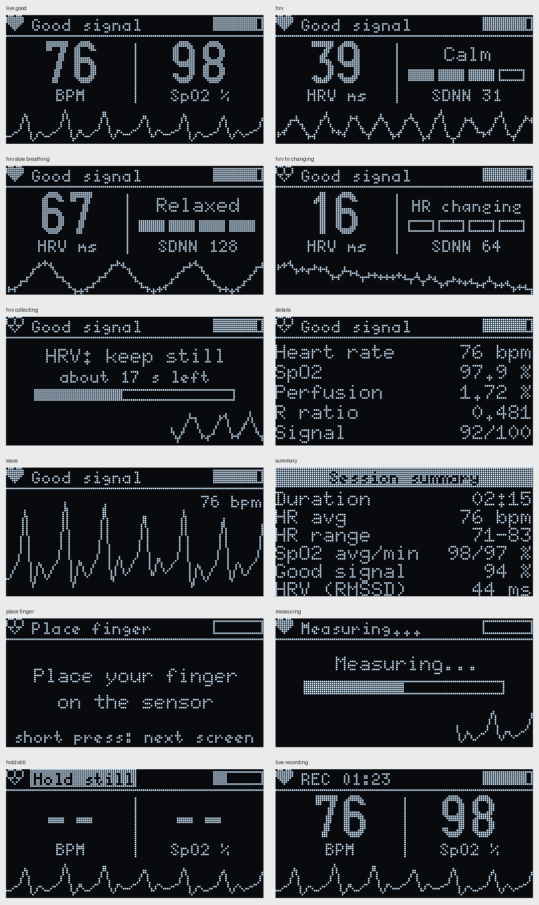

# PulseLab

Pocket vitals analyzer using a MAX30100 sensor and an ESP32-C3 Super Mini. This is my minor project.

The idea is simple: instead of just using a library and printing BPM, I want to work with the raw PPG signal from the sensor and do the processing myself. From the same signal I'm planning to get heart rate, SpO2, HRV (for a stress estimate) and breathing rate, show it on an OLED and send it over BLE to a web page. At the end I'll compare my readings with a normal fingertip pulse oximeter to see how accurate it really is.

Note: this is a student project, not a medical device.

## Hardware

- ESP32-C3 Super Mini
- MAX30100 module (green board)
- 1.3" OLED, I2C (SH1106)
- 2 x 4.7k resistors (I2C pull-ups)
- Li-Po battery + TP4056 charger (later)
- Push button on GPIO4 (switch screens, start/stop a session)
- Vibration motor (later)
- Zero PCB + 3D printed case (later)

Wiring and parts list: [docs/HARDWARE.md](docs/HARDWARE.md)

Problems I ran into and how I fixed them: [docs/DEBUG_LOG.md](docs/DEBUG_LOG.md)



## Folders

```
docs/          plan, hardware notes, debug log, images
firmware/      Arduino sketches, one folder per phase
tests/         PC tests for the signal processing code
validation/    accuracy test script, Serial recorder, beat interval checker, raw logs
dashboard/     web bluetooth page (later)
enclosure/     3D design files (later)
hardware/      perfboard layout and photos (later)
```

## How to run

1. Arduino IDE with the esp32 board package (Espressif).
2. Board: ESP32C3 Dev Module, and turn on "USB CDC On Boot", otherwise nothing shows in Serial.
3. Install MAX30100lib by OXullo Intersecans and U8g2 by olikraus. If you have any other MAX30100 library installed, remove it (see debug log).
4. Wire it as in HARDWARE.md and upload the latest phase folder (now `firmware/05_hrv`).
5. Keep your finger lightly on the sensor. The OLED shows the values, and Serial Monitor (115200) shows one line per beat.

## Progress

- [x] Phase 0: check the modules, fix the I2C pull-up problem
- [x] Phase 1: get the raw signal
- [x] Phase 2: filtering and heart rate
- [x] Phase 3: SpO2 and perfusion index
- [x] Phase 4: OLED screens, button, signal quality
- [x] Phase 5: HRV and stress level
- [x] Phase 6: breathing rate
- [x] Phase 7: guided breathing mode
- [ ] Phase 8: BLE + web dashboard
- [ ] Phase 9: battery
- [ ] Phase 10: zero PCB and 3D case
- [ ] Phase 11: accuracy test vs commercial oximeter
- [ ] Phase 12: final report and demo

Full plan with what each phase involves: [docs/ROADMAP.md](docs/ROADMAP.md)

Notes per phase:
- [Phase 2: filtering and heart rate](docs/phase2_heart_rate.md)
- [Phase 3: SpO2 and perfusion index](docs/phase3_spo2.md)
- [Phase 4: OLED screens, button and signal quality](docs/phase4_display.md)
- [Phase 5: HRV and stress level](docs/phase5_hrv.md)
- [Phase 6: breathing rate](docs/phase6_breathing.md)
- [Phase 7: guided breathing](docs/phase7_guided.md)
- [Phase 8: Bluetooth and web dashboard](docs/phase8_ble.md) (built, testing on the board)

Live dashboard (Chrome/Edge, needs the board, or press Demo): `dashboard/` - see [dashboard/README.md](dashboard/README.md)

PC tests and screen renders: [tests/README.md](tests/README.md)

Research papers the methods are based on: [docs/REFERENCES.md](docs/REFERENCES.md)

## Results so far

Measured on my own finger, sitting still. Not a medical device, and the SpO2 formula isn't calibrated yet (Phase 11).

| What | Result |
|---|---|
| Heart rate vs phone app (3 readings) | PulseLab 2-6 BPM lower, average -3.9 BPM |
| Beat timing check | intervals from the ESP32 matched the Serial timestamps within 1% |
| SpO2 (uncalibrated) | 97.6-98.4% sitting still, R about 0.47 |
| Perfusion index | about 1.6-2.8% |
| OLED | 25 fps, ~14 ms per frame, no sensor FIFO stalls in 2 min |
| Beat intervals, 2 min still | 1 of 132 rejected (no OLED), 7 of 137 rejected (with OLED) |
| HRV (RMSSD), 2 min still | 38.9 ms and 48.8 ms in two recordings ("Calm") |
| HRV, sitting vs slow breathing (6/min) | about 36 ms ("Calm") vs about 60 ms ("Relaxed"), 2.5 min each |
| Breathing rate vs the pacer (6, 10, 15, 20 /min) | every shown value within 2 /min, mean error 0.1-0.3; shown 12-100% of the time |
| Breathing rate, free breathing | 31.3 /min (median) vs ~32 counted by hand |
| Guided breathing (1 min / 3 min at 6 per min / 1 min) | HRV 13 -> 28 -> 13 ms, HR swing 21 BPM per breath, breathing measured 6.2 /min |

Details and how each was measured are in the phase notes.

## License

MIT
