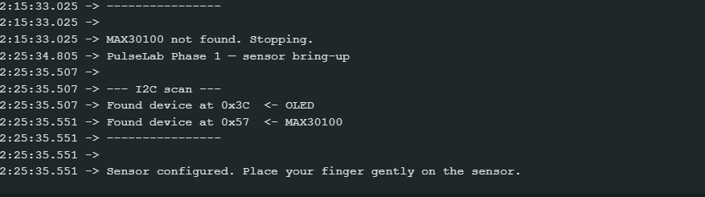
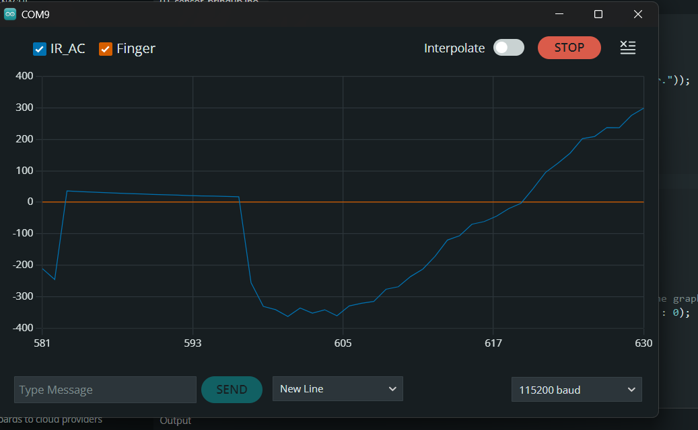

# Engineering Debug Log

Problems found while building PulseLab, how they were diagnosed, and how they were fixed.

---

## Issue 1: Wrong MAX30100 library selected at compile time

**Date:** 2026-10-19 · **Phase:** 1

**Symptom**
Compilation failed with errors such as `could not convert 'sensor.MAX30100::begin(pw1600, i50, sr100)' from 'void' to 'bool'` and `'class MAX30100' has no member named 'setMode'`.

**Diagnosis**
The error showed a `begin()` with a different signature from the library the firmware was written for. A second MAX30100 library was installed that also provides a file named `MAX30100.h`, and the Arduino IDE picked that one instead of *MAX30100lib by OXullo Intersecans*.

**Fix**
- Removed the conflicting library in Library Manager.
- Added `#include "MAX30100_PulseOximeter.h"` before `#include "MAX30100.h"`. That header exists only in OXullo's library, so the IDE always resolves to the correct one.

**Lesson**
When two libraries share a header name, the compiler error describes the library that was actually used. Read the function signatures in the error, not just the error message.

---

## Issue 2: MAX30100 module pulls the I²C bus to 1.8 V

**Date:** 2026-10-19 · **Phase:** 0

**Symptom**
With the MAX30100 (green module) and 1.3" OLED connected, the I²C scanner reported devices at almost every address (0x34–0x7D), the scan took several seconds, and the firmware printed `MAX30100 not found`.

**Diagnosis**

| Step | Test | Result | Conclusion |
|---|---|---|---|
| 1 | Reasoning about the scan | "Devices" at nearly every address | A real bus can't have that many devices. SDA must be read as LOW constantly, so the scanner sees a false ACK at every address. |
| 2 | Disconnected the MAX30100, scanned with only the OLED | Only `0x3C` found | OLED, wiring and ESP32 are fine. The MAX30100 module is the fault. |
| 3 | Powered the MAX30100 alone (VIN, GND), measured SDA→GND with a multimeter | **≈ 1.8 V** | The module's I²C pull-up resistors are connected to its internal 1.8 V regulator, not to VIN. |

**Root cause**
The module's on-board 4.7 kΩ pull-up resistors (SDA, SCL, INT) are tied to the 1.8 V rail that powers the MAX30100 chip. The ESP32-C3's minimum input-high voltage is 0.75 × VDD = 0.75 × 3.3 V ≈ **2.48 V**. A 1.8 V "high" is below that threshold, so the ESP32 reads the bus as permanently LOW.

**Options considered**

| Option | Pros | Cons | Decision |
|---|---|---|---|
| A. Remove the 3 pull-up resistors, add external 4.7 kΩ pull-ups to 3.3 V | Doesn't touch the chip's power; low risk; standard fix | Needs SMD desoldering | **Chosen** |
| B. Cut the trace from the 1.8 V regulator to the pull-ups, jumper them to 3.3 V | No extra resistors | The 1.8 V rail also powers the MAX30100 core. A wrong cut or a slip puts 3.3 V on a ~1.8 V supply and can destroy the chip. Hard to see the trace on a small board. | Rejected |

Option A is safe because the MAX30100's SDA/SCL pins are open-drain and tolerate voltages well above 3.3 V; only its supply pin is limited to ~1.8 V.

**Fix**
1. Found the three pull-up resistors with a multimeter in continuity mode (probe on the SDA/SCL/INT pin, beep on the resistor end).
2. Desoldered all three.
3. Added external pull-ups: 4.7 kΩ from SDA (GPIO6) to 3.3 V and 4.7 kΩ from SCL (GPIO7) to 3.3 V.

**Verification**
- SDA→GND and SCL→GND both measure ≈ 3.3 V.
- I²C scan finds exactly two devices: `0x3C` (OLED) and `0x57` (MAX30100).
- Raw PPG waveform visible in the Serial Plotter.

_To add: before/after close-up photos of the module (`docs/images/module_before.jpg`, `module_after.jpg`)._

**Lesson**
Breakout boards can be designed for a different logic voltage than your microcontroller. Isolate one device at a time, then measure; don't guess.
