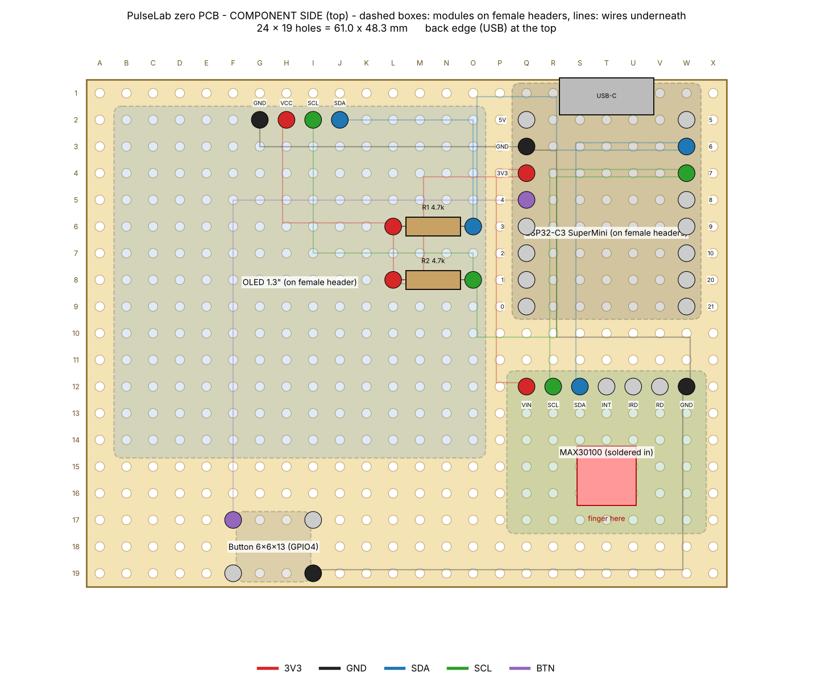
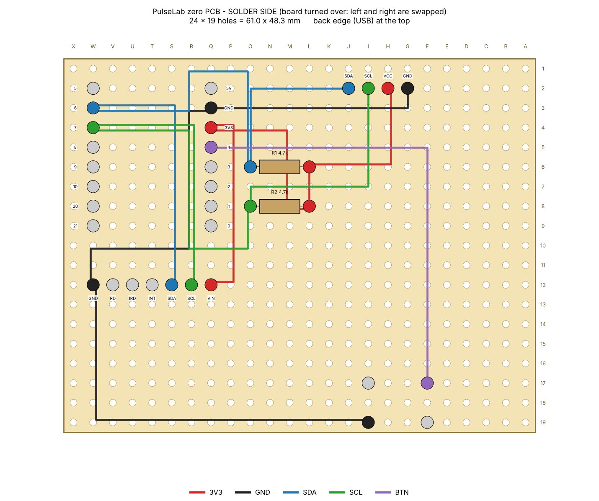
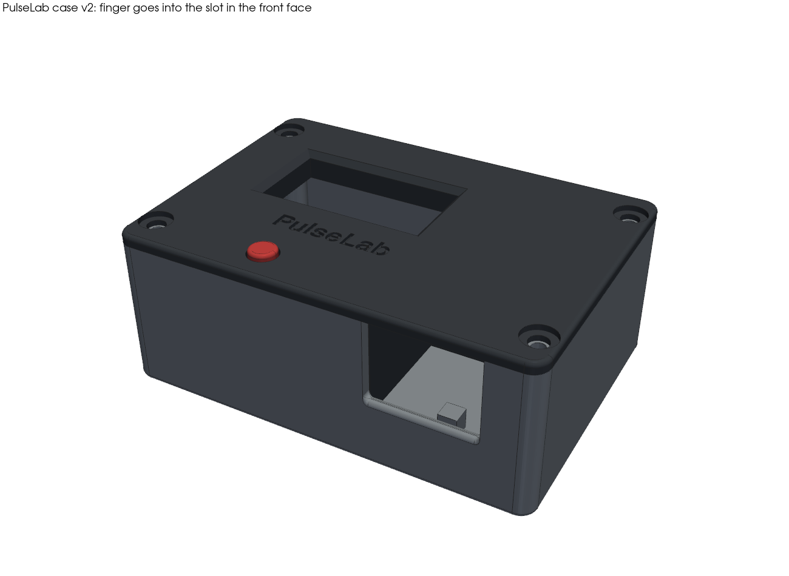
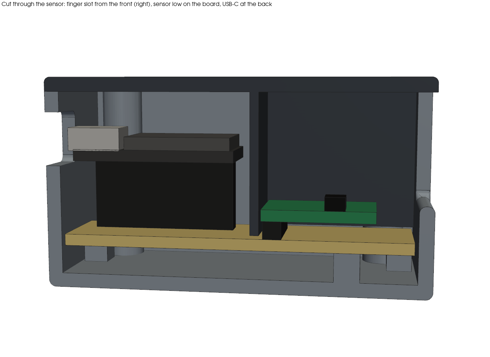
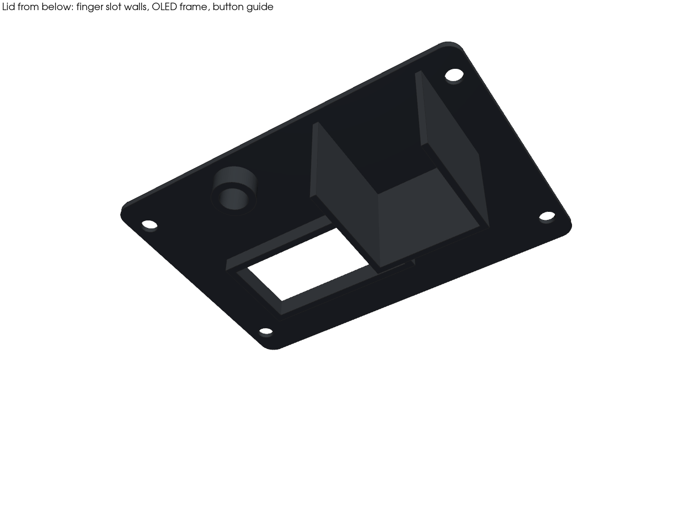
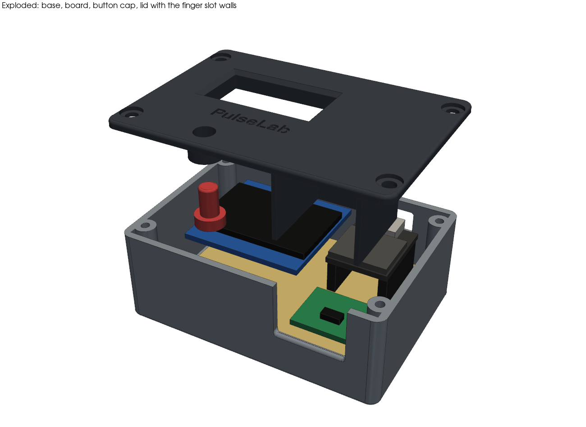

# Phase 10: zero PCB and case

Layout: `hardware/layout.py` (makes the two pictures below and the wire list).

Status: layout done (checked by `hardware/layout.py`), case designed (checked by `enclosure/case.py`). Next: print the fit-test plate, then the case, and test the readings in it.

## Decisions

- **Display: staying with the 1.3" OLED.** I also have a 2" TFT, but the OLED already works with all the screens, uses less power and keeps the case small. The TFT notes stay in ROADMAP for later.
- **Power: USB only** (Phase 9 moved to future work). So the board has no battery, charger, switch or motor.
- **OLED and ESP32 sit on female headers**, not soldered in. If one dies, or I need the ESP32 for something else, it just pulls out.
- **The MAX30100 is soldered straight into the board** with its own header pins (changed after the first case design, see [The case](#the-case)). That puts the sensor low, so the finger can slide in sideways through a slot in the front of the box and lie on it, and the case stays a plain box.
- **Wiring is point to point** with thin insulated wire on the solder side, from pin to pin. No long solder bridges along the rows, they're hard to fix and easy to short.

## Board size

**Cut 24 x 19 holes: about 61 x 48 mm.** Cut through the next row of holes (the 25th column and the 20th row), then file the edge flat. That leaves half a hole spacing (1.27 mm) outside the outer holes.

Holes are named like a chess board: column letter A-X, row 1-19. **A1 is the top-left hole looking at the component side, with the back edge (where the USB plug goes in) at the top.** I marked A1 on the board with a marker before starting.

Where things go (component side, back edge at the top):

| Part | Where | Notes |
|---|---|---|
| OLED 1.3" | 4-pin female header at G2-J2 (GND, VCC, SCL, SDA) | the screen hangs over the left part of the board, rows 2-14 |
| ESP32-C3 SuperMini | two 8-pin female headers, Q2-Q9 and W2-W9 | USB-C at the back edge |
| MAX30100 | its 7 header pins soldered straight into Q12-W12 (VIN, SCL, SDA, INT, IRD, RD, GND) | sensor window to the front-right, the finger goes here |
| R1 4.7k | L6 to O6 | SDA pull-up, lies flat under the OLED |
| R2 4.7k | L8 to O8 | SCL pull-up, lies flat under the OLED |
| Button 6x6, 13 mm tall | legs at F17, I17, F19, I19 | only the diagonal legs F17 and I19 are used |

So the screen is on the left, the finger rests on the right, and the button is in front of the screen. The four corner holes (A1, X1, A19, X19) are left empty for the case.

Why the button uses diagonal legs: a 4-leg button has two pairs of legs that are always connected, and which pair is which depends on the button. The two diagonal legs are always on different sides of the switch, so it works whichever way round it goes in.

The resistors fit under the OLED because the OLED is raised on its header (about 8.5 mm) and a flat resistor is about 2.5 mm tall.

## Wiring

All wires go on the solder side. This is how it looks with the board turned over (left and right are swapped):

The lines in the pictures are just a suggested path. What matters is which two holes each wire connects. Each net is a chain, so no hole has more than two wires on it:

| # | Net | From | To | Cut about |
|---|---|---|---|---|
| 1 | 3V3 | H2 OLED VCC | L6 R1 | 30 mm |
| 2 | 3V3 | L6 R1 | L8 R2 | 15 mm |
| 3 | 3V3 | L8 R2 | Q4 ESP32 3V3 | 33 mm |
| 4 | 3V3 | Q4 ESP32 3V3 | Q12 MAX30100 VIN | 35 mm |
| 5 | GND | G2 OLED GND | Q3 ESP32 GND | 38 mm |
| 6 | GND | Q3 ESP32 GND | W12 MAX30100 GND | 48 mm |
| 7 | GND | W12 MAX30100 GND | I19 button | 63 mm |
| 8 | SDA | J2 OLED SDA | O6 R1 | 33 mm |
| 9 | SDA | O6 R1 | W3 ESP32 GPIO6 | 48 mm |
| 10 | SDA | W3 ESP32 GPIO6 | S12 MAX30100 SDA | 43 mm |
| 11 | SCL | I2 OLED SCL | O8 R2 | 40 mm |
| 12 | SCL | O8 R2 | W4 ESP32 GPIO7 | 51 mm |
| 13 | SCL | W4 ESP32 GPIO7 | R12 MAX30100 SCL | 43 mm |
| 14 | BTN | Q5 ESP32 GPIO4 | F17 button | 68 mm |

About 60 cm of wire in total. Same connections as the breadboard (HARDWARE.md), nothing new in the circuit: SDA = GPIO6, SCL = GPIO7, button = GPIO4 to GND (internal pull-up). INT, IRD and RD on the sensor, and 5V on the ESP32, stay unconnected.

The script checks the layout before drawing it: no two raised modules overlap, every pin that needs a wire has one, each wire joins two pins of the same net, no hole has more than two wires, and no wire path passes over another pin.

## Parts

| Qty | Part |
|---|---|
| 1 | zero PCB (perfboard), at least 25 x 20 holes |
| 1 | 4-pin female header (OLED) |
| 2 | 8-pin female header (ESP32) |
| 1 | 7-pin male header (usually comes with the sensor), soldered to the sensor and straight into the board |
| 1 | spare 4-pin male header, only its plastic strip (pins pulled out), to lift the OLED 2.5 mm |
| 4 | M3 screws, 8-10 mm (case) |
| 2 | 4.7k resistor |
| 1 | 6x6 push button, 13 mm tall |
| - | thin insulated wire (wire-wrap or 26-30 AWG), 4 colours if possible: red 3V3, black GND, blue SDA, green SCL |

## Soldering order

1. **Cut and mark** the board, write A1 on the corner.
2. **Female headers first.** Plug each module into its header, put it in the board, and solder only one pin of each header. Check it's straight, fix it if not, then solder the rest. The module itself is the best jig to get the spacing right (especially the two ESP32 rows). Then take the modules out again.
3. **Resistors**, flat against the board.
4. **Button**, pressed flat.
5. **Wires**, one net at a time in the order of the table. Strip about 3 mm, wrap it around the leg of the header pin on the solder side, solder. After each net, check it with the multimeter before starting the next one. The sensor isn't in yet, so wires 4, 6, 7, 10 and 13 go to the empty holes Q12, W12, S12 and R12: just push the wire through the hole and leave it ready.
6. Do the checks below.
7. **Sensor last.** Push its header pins (plastic strip under the sensor board, sensor window facing up) into Q12-W12 and solder each pin together with the wire waiting in that hole. Make sure the sensor board is flat and parallel to the zero PCB, because the finger lies on it.
8. Cut off long legs (resistors, button, sensor pins), so nothing touches the bottom of the case. Under the board there's 4 mm of room.

## Checks before power

With **no modules plugged in and the sensor not soldered yet**, multimeter on beep mode:

| Check | Holes | Expect |
|---|---|---|
| 3V3 net | H2, L6, L8, Q4, Q12 | all beep to each other |
| GND net | G2, Q3, W12, I19 | all beep to each other |
| SDA net | J2, O6, W3, S12 | all beep |
| SCL net | I2, O8, W4, R12 | all beep |
| Button | Q5 to I19 | beeps only while the button is pressed |
| Shorts | 3V3-GND, SDA-SCL, SDA-GND, SCL-GND, SDA-3V3, SCL-3V3 | no beep |
| Pull-ups | SDA to 3V3, SCL to 3V3 (resistance mode) | about 4.7k each |

Also look at it with the phone camera zoomed in for solder blobs between pins.

## First power-up

1. Before soldering the sensor: only the ESP32 plugged in, USB connected. Measure 3V3 to GND at Q12 and W12: about 3.3 V.
2. Unplug, solder the sensor, plug in the OLED (with the spare plastic strip on its pins, see the case), connect again.
3. Upload `firmware/01_sensor_bringup`. The I2C scan should show only **0x3C (OLED) and 0x57 (MAX30100)**, same as Phase 0.
4. Upload `firmware/08_ble`, check all screens, the button, and the dashboard over Bluetooth.
5. Record a raw file like in Phase 6 and compare with the breadboard recordings, to be sure the board didn't add noise.

| Check | Breadboard | Zero PCB |
|---|---|---|
| I2C scan | 0x3C, 0x57 | |
| Resting BPM vs phone | within 3 | |
| `loop max` / FIFO resets | 64 ms / 0 | |
| Signal quality score at rest | | |

## Things I still need to check on my modules

The layout uses typical sizes. Before soldering, I need to compare these with my actual parts (and change the numbers in `layout.py` if they're different):

- **ESP32-C3 SuperMini pin order.** The layout assumes, looking from the top with USB at the top: left side 5V, GND, 3V3, 4, 3, 2, 1, 0 and right side 5, 6, 7, 8, 9, 10, 20, 21, with the two rows 15.24 mm apart (6 holes). Check against the labels printed on the board.
- **MAX30100 pin order and size.** Assumed VIN, SCL, SDA, INT, IRD, RD, GND in one row, board about 19 x 15.5 mm, sensor window about 8.5 mm from the pin row. Since it gets soldered in, this one really has to be right before soldering.
- **OLED size.** Assumed 35.4 x 33.5 mm with the 4 pins along the top edge in the order GND, VCC, SCL, SDA. Some 1.3" boards have VCC and GND swapped, which would destroy it if wired wrong.

## The case

Files: `enclosure/` (STEP for Fusion 360, STL for the Neptune 4), made by `enclosure/case.py`.

### Why it changed (v1 -> v2)

My first design had everything on female headers, so the sensor was at the same height as the OLED (about 14 mm above the board), and a finger hood stuck up on top of the lid. I didn't like that, so I changed it:

- the sensor is soldered straight into the board, so its window is only about 6 mm above the board
- the finger goes in **sideways through a slot in the front face** and lies on the sensor inside the box
- the lid above the finger is the roof of the slot, so the case is a **plain box** (76 x 53 x 30 mm) and the box itself keeps the room light off the sensor

### Heights

Measured from the top of the zero PCB. On female headers: module boards about 12 mm, OLED glass 14 mm, USB-C socket 15 mm. Button 13 mm. Sensor soldered in: window about 6 mm (2.5 mm header plastic + 1.6 mm board + the chip).

- **Lid underside at 20 mm** = sensor window + 14 mm of room for the finger.
- **OLED lifted 2.5 mm**: the plastic strip of a spare male header (pins pulled out) goes on the OLED's pins before plugging it in. The pins still go about 3.5 mm into the female header. That brings the glass to 16.5 mm, 5.5 mm below the lid top. Without the strip it would be 8 mm deep. Under the lid there's a frame around the window that goes down to just above the glass, so you look at the screen and not into the box.
- **Button:** the printed cap is now 11 mm long, guided by a tube under the lid so it can't tilt. A flange under the tube stops it from falling out.
- The ESP32 and its USB-C socket are far below the lid now, so the USB opening is a plain hole in the back wall.

### Finger slot

- Opening in the front face: 20 mm wide, from 1 mm below the sensor window up to the lid (14 mm room above the window), with rounded edges.
- Under the lid there are three walls around the sensor: left, right, and a fingertip stop just behind the sensor board. The fingertip always ends up about 10 mm past the sensor window, which is about where the pad of the fingertip is.
- These walls go down to 0.5 mm above the board. So the slot is closed off from the rest of the box, and light from the OLED window can't reach the sensor. The only way light gets in is the front opening, and the finger fills most of it.

### Other details

- **Board:** sits on 4 corner posts plus 1 post under the sensor (so pressing with the finger doesn't bend the board), all on holes with no wires.
- **4 M3 screws** (8-10 mm) through the lid into columns on the left and right. The holes in the columns are 2.5 mm, so the screws cut their own thread. The heads sit in 1 mm counterbores.
- `case.py` checks the design: it models the board, modules, headers, USB socket, button **and the space the finger needs** as boxes, and checks that no part of the case gets in the way. (In the first version of the slot, the left wall overlapped the sensor board by 0.05 mm, and the check caught it.)

### Printing (Neptune 4)

| Part | Orientation (as in the STL) | Settings |
|---|---|---|
| Fit-test plate | flat | 0.2 mm layers |
| Base | upright | 0.2 mm, 3 walls, 15-20% infill, no supports |
| Lid | upside down: flat top on the bed, walls going up | 0.2 mm, 3 walls, no supports. The flat top gets the bed's smooth finish. |
| Button cap | flange down | 0.12 mm layers |

Filament: black (or at least dark and not see-through) PLA or PETG, so no light gets through the walls to the sensor.

### Before printing the full lid

Print `fit_test_plate.stl` first and put it on the board (resting on the OLED). Check:

1. The OLED window is over the lit part of the screen. I didn't have the exact position of the lit area on my OLED module, so it's set to 16 mm from the pin edge of the module (`OLED_ACTIVE_FROM_TOP`).
2. The button is centred in its hole, and the screw holes line up with the case.

After soldering the sensor, measure the height of its window above the zero PCB and put it in `SENSOR_TOP` in `case.py` (I assumed 6 mm), then run the script again.

### Things to check after assembly

| Check | Result |
|---|---|
| Lid closes without pressing on anything | |
| Button cap clicks the button every time | |
| USB cable plugs in fully | |
| Finger slides in and lies flat on the sensor | |
| Readings in the case vs on the breadboard (resting BPM, quality score) | |
| Readings next to a bright window / lamp (light getting in?) | |
