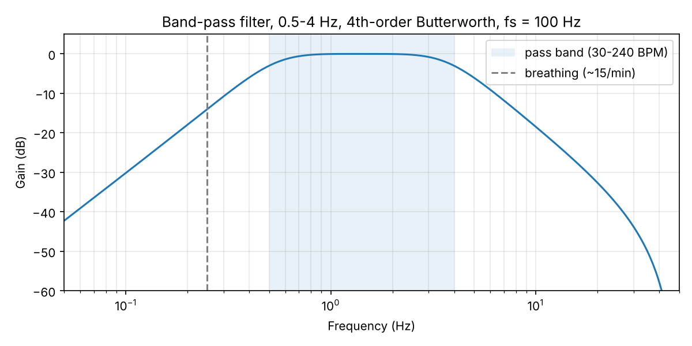
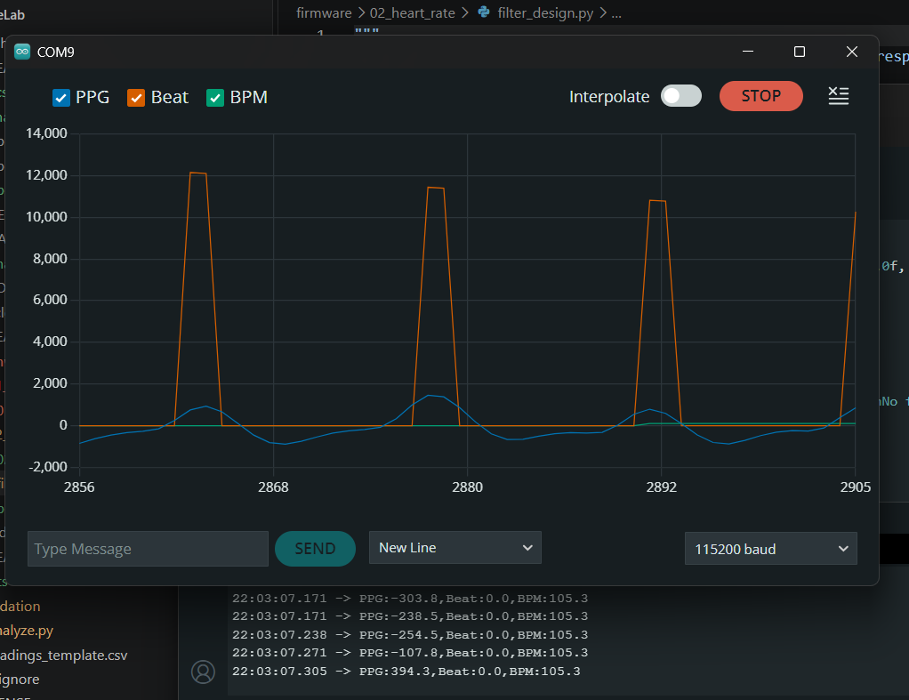
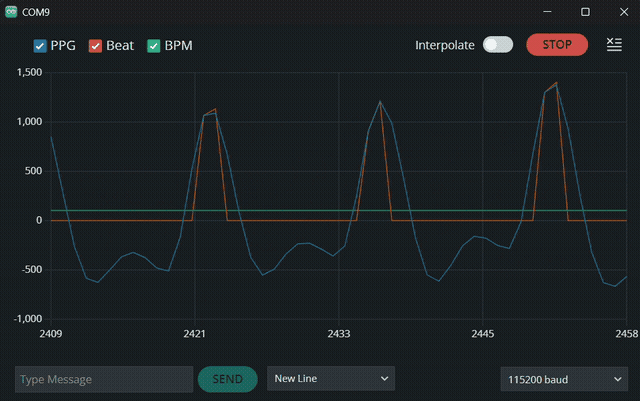

# Phase 2: filtering and heart rate

Code: `firmware/02_heart_rate/`. All the signal processing is in `ppg_dsp.h`, the `.ino` only reads the sensor and prints.

## How it works

```
raw IR -> remove DC -> band-pass 0.5-4 Hz -> invert -> slope -> find beats -> intervals -> BPM
```

**Remove DC.** The raw IR value is around tens of thousands, and the pulse is only a small part of it. A slow average (about 1 s) tracks that level and gets subtracted. For the first 2 s after a finger is placed the average follows much faster (about 0.1 s), because the IR jumps from ~150 to ~46000 and the slow one would take too long to catch up.

**Band-pass filter.** 4th-order Butterworth, 0.5 to 4 Hz (30 to 240 BPM), made of two biquad sections. Coefficients come from `filter_design.py` (scipy). This removes slow drift and fast noise.



One thing the plot shows: breathing (around 0.25 Hz) is only reduced by about 14 dB, so it doesn't fully disappear. That turned out to matter (see below).

**Invert.** More blood in the finger absorbs more IR light, so each heartbeat is actually a dip in the raw reading. Flipping the signal makes every beat a positive peak.

**Detect on the slope, not the peak.** I take the rise of the signal over the last 40 ms and look for peaks in that. The start of each pulse rises very sharply, while breathing drift is slow, so in the slope the beats stand out much more. The moment of fastest rise is also a steadier timing point than the top of the peak, which will help later for HRV.

**Adaptive threshold.** A beat must be above 50% of the recent maximum slope. That maximum slowly decays (half-life about 3.5 s) so it follows the signal if it gets weaker. Two extra rules came from testing on my finger:
- it starts at the pulse size measured during the settling time, not at zero
- if no beat is found for 1.5x the normal interval (or 1.5 s at the start), it drops much faster (half-life about 0.35 s). Otherwise one bump from moving the finger pushes the threshold so high that beats are missed for 6-9 s.

**Avoiding double counting.** Each pulse has a smaller second bump (the dicrotic wave) about 250-350 ms after the main one. Three things stop it from counting as a beat:
- after a beat, wait until the signal starts falling before looking for the next one
- no beat within 300 ms of the last one
- once the heart rate is known, no beat within 60% of the normal interval

**Intervals to BPM.** Intervals outside 300-2000 ms (200-30 BPM) are ignored. An interval more than 30% away from the median of recent ones is treated as a missed or extra beat and rejected. If three in a row get rejected, the heart rate probably really changed, so it starts over. BPM is the average of the last 8 good intervals. The first BPM is only shown once the first 3 intervals agree with each other.

Time is counted in samples (10 ms each), not with `millis()`, because the sensor gives samples in bursts from its FIFO.

## Testing on the PC first

`tests/test_heart_rate.cpp` runs the same `ppg_dsp.h` on a simulated pulse signal (DC level, breathing drift, main pulse + second bump, beat-to-beat variation, random noise).

```
g++ -std=c++17 -O2 -I firmware/02_heart_rate tests/test_heart_rate.cpp -o test_hr
./test_hr
```

My first version found peaks directly in the filtered signal. It worked for normal signals, but when the breathing drift was bigger than the pulse it missed about half the beats. Switching to the slope fixed that, but then on weak signals it sometimes counted the second bump as an extra beat, which is why I added the extra rules above and tuned the threshold.

Final results on the simulated signals:

| Test | Reported BPM | Actual BPM |
|---|---|---|
| Normal signal, 72 BPM | 71.1 | 71.2 |
| Slow, 45 BPM | 44.7 | 44.7 |
| Fast, 150 BPM | 147.7 | 148.0 |
| Change 60 -> 100 BPM | 60.5 -> 99.6 | 60.5 -> 99.5 |
| Finger removed and put back | 0 while off, then 74.1 | 74.1 |
| Weak signal | 80.5 | 80.6 |
| Breathing drift bigger than pulse | 69.5 | 70.0 |
| Very strong signal | 89.9 | 89.9 |
| Finger placed (IR rising over 300 ms) | 90.2, shown after 4.8 s | 89.7 |
| Finger pressed harder for a moment | 107.1, shown after 6.5 s (old code: 14 s) | 107.2 |

The simulated signal is only an approximation. The real check is on my own finger against a pulse oximeter.

## Testing on real hardware

First run, 19 Oct 2026, my finger, sitting:

- Raw IR with finger about 46,000-47,000, without finger 129-159. So `FINGER_IR_MIN = 10000` works fine.
- One beat detected per pulse, nothing rejected. Intervals 550-580 ms, BPM 104-106.
- To check the timing I compared the intervals the ESP32 reported with the time between the Serial Monitor lines. Average 565.6 ms reported vs 570.6 ms from the timestamps, so the sample rate really is 100 Hz.
- Finger removed: shows "No finger" and BPM goes to 0.



In this first run the beat marker (orange) was about 12,000 tall while the pulse was about 1,000. It was scaled from the biggest signal seen, and the jump from placing the finger was included in that. Fixed by ignoring the settling time and letting the scale shrink faster. The same jump was also making the start of the measurement noisier than needed, which is where the faster DC tracking during settling came from.

Second run (screen recording), after the fixes for the plotter and the start-up jump:



- One beat marker per pulse, sitting on the steep rising edge. The small bump between beats is the second wave of each pulse and isn't counted.
- BPM stayed between 103 and 107.
- But the first BPM shown was 85.7, and it took a few seconds to climb to ~105. In the PC simulation I could get the same thing by adding a short finger-pressure bump just after settling: the threshold jumped up and beats were missed for 6-9 s. That's where the two extra threshold rules and the "first 3 intervals must agree" check came from (test 9).
- Right after uploading, it printed "MAX30100 not found" and only worked after unplugging the board. See debug log #6.

Compared with a reference (to fill in):

| Reading | PulseLab BPM | Phone / oximeter BPM | Difference |
|---|---|---|---|
| 1 | 92.2 | 98 (phone) | -5.8 |
| 2 | 93 | 97 (phone) | -4 |
| 3 | 90 | 92 (phone) | -2 |

Average difference -3.9 BPM. All three are lower than the phone, so there may be a small offset, but 3 readings against a phone camera app isn't enough to say which one is off. To check: count beats in Serial Monitor mode for exactly 60 s while counting my pulse at the wrist. If those match, beat detection is right and the difference comes from averaging or the phone. Will also check against a proper oximeter in Phase 11.
