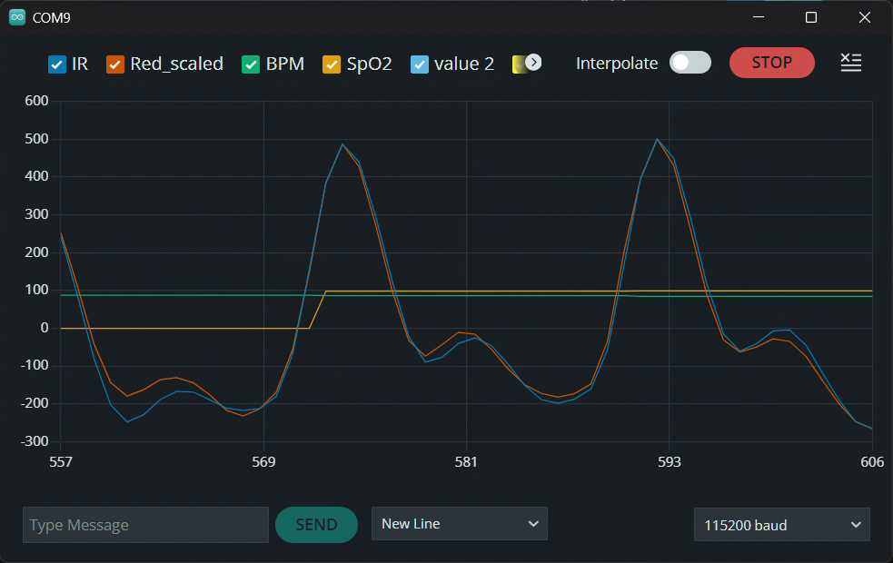

# Phase 3: SpO2 and perfusion index

Code: `firmware/03_spo2/`. `ppg_dsp.h` is the same as Phase 2, the new part is `spo2.h`.

## The idea

Blood with oxygen (oxyhaemoglobin) and blood without (deoxyhaemoglobin) absorb red and infrared light differently. Deoxygenated blood absorbs much more red light. The MAX30100 shines red (660 nm) and IR (880 nm) alternately through the finger, so comparing how much each one pulses tells you roughly how much of the blood is carrying oxygen.

The problem is that the raw brightness depends on the finger, the skin, how hard you press and the LED. To cancel that out, each channel's pulsing part (AC) is divided by its steady part (DC):

```
R    = (AC_red / DC_red) / (AC_ir / DC_ir)      "ratio of ratios"
SpO2 = 110 - 25 * R
PI   = AC_ir / DC_ir * 100 %                    perfusion index
```

Normal R is around 0.4-0.6. `110 - 25R` is a common textbook starting point, not calibrated for my sensor. In Phase 11 I'll replace the two numbers with my own, fitted against a real oximeter.

## How the code does it

The heart rate code already finds each beat. I use those beats to cut both signals into one window per heartbeat:

- red goes through the same DC removal and the same band-pass filter as IR. Because the filter is identical, it changes both channels the same way and the ratio isn't affected
- AC = peak-to-trough of the filtered signal in that window
- DC = average raw value in that window
- the window is only used if the heart rate code accepted that interval, nothing clipped, and R is between 0.2 and 2.0
- SpO2 and PI are the median of the last 8 good beats, shown after 4. Median instead of average so one bad beat doesn't move the number

If the raw value goes above 65000 (the 16-bit ADC is nearly full) the beat is skipped, because a clipped pulse looks smaller than it really is.

## Tests

`tests/test_spo2.cpp` simulates a finger with a known R built in, then checks the code finds it again.

```
g++ -std=c++17 -O2 -I firmware/03_spo2 tests/test_spo2.cpp -o test_spo2
./test_spo2
```

| Test | Got | Should be |
|---|---|---|
| Normal, R 0.5 | 97.5 | 97.5 |
| R 0.7 / R 1.0 | 92.5 / 85.0 | 92.5 / 85.0 |
| Red much darker than IR, and the other way round | 97.7, 97.5, 97.5 | 97.5 |
| Weak pulse (PI 0.5%) + noisy red | 96.2 | 97.5 |
| Heart rate 140 / 50 | 97.7 / 97.4 | 97.5 |
| Red LED clipping | no SpO2 shown | no SpO2 |
| Finger off and back on | 0 while off, then 97.4 | |
| Finger pressed harder for a moment | 97.3 | 97.5 |
| Oxygen dropping 97.5 -> 90 over 60 s | 90.5 at the end | 90.0 |

The DC test is the important one: the SpO2 doesn't change when the LED brightness or finger changes, which is the whole point of dividing by DC.

### Weak pulses

SpO2 got worse when the pulse was weak, so I checked it properly (6 runs each, average error):

| PI | red noise 8 | red noise 15 | red noise 30 |
|---|---|---|---|
| 2% | +0.04 | +0.07 | +0.09 |
| 1% | +0.03 | +0.04 | -0.06 |
| 0.5% | -0.55 | -0.68 | -1.33 |
| 0.3% | -1.29 | -1.58 | -3.26 |

Above 1% PI it's basically exact. Below 0.5% it reads too low.

I tried a different way to get R: a least-squares fit of red against IR over the beat, instead of peak heights. Random noise in red doesn't match the IR signal, so I expected it to average out. It didn't help: it was worse at 1% PI and about the same at 0.3%. Looking closer, the main problem at low PI isn't noise but breathing. Breathing changes the brightness of red and IR by the same fraction (R = 1), and when the pulse is tiny, that leaks into the result. So I kept the simpler peak-to-trough version.

What I did instead: the code sets a `lowPerfusion` flag when PI is under 0.5%, and the Serial Monitor prints "SpO2 not reliable". In Phase 4 the screen will show a warning instead of a number. My finger had PI around 3-4% in Phase 2, so normally this isn't a problem.

## Testing on real hardware

First run, 20 Oct 2026 (after fixing debug log #7):



- The red wave (scaled to the same height) lies almost exactly on top of the IR wave, including the small second bump of each pulse. So the red channel is clean, which matters because SpO2 depends on it.
- BPM 84.7, SpO2 about 98% (read off the plot, the Serial lines were cut off in my recording). 98% is normal, but the formula isn't calibrated yet.
- SpO2 appeared a few seconds after BPM, as expected (it needs 4 good beats).

Serial Monitor run, 20 Oct 2026, sitting still, about 12 s (16 beats):

| | Value |
|---|---|
| Raw IR / raw red | ~48,000-49,000 / ~38,800-39,400 |
| BPM | 74.5-77.5 |
| R (median shown) | 0.466-0.495 |
| SpO2 shown | 97.6-98.4% |
| PI (median shown) | 1.59-1.97% |
| R of single beats | 0.363-0.566, mean 0.481, SD 0.050 |
| PI of single beats | 0.88-2.33% |

What this tells me:
- **LED brightness is fine.** Red at ~39,000 and IR at ~49,000 are both well above the noise and well below the 65,535 limit, so no need to change the LED currents.
- **One beat on its own is noisy.** Single-beat R goes from 0.36 to 0.57, which would mean SpO2 jumping between ~96% and ~101% every beat. The median over 8 beats only moved between 97.6 and 98.4. That's why the median is there.
- **PI ~1.6-2%** is a normal resting finger value and well above the 0.5% where SpO2 gets unreliable. It's a bit lower than the real AC/DC because the band-pass filter takes off some of the pulse height (about 7% in the simulation), but that affects red and IR the same way so R isn't affected.
- **R ~0.48 → 98%** with the textbook formula. Normal for a healthy person, but the formula isn't calibrated yet (Phase 11).

One thing I noticed: the very last beat before "No finger" was a 580 ms interval (the others were ~800). That was my finger lifting off, not a heartbeat. It got accepted because it's only 28% off the median and the limit is 30%. It barely matters for BPM, but for HRV in Phase 5 one fake interval like that makes a big difference, so I'll need to throw away the last beat or two before the finger is removed.

Optional extra check: hold my breath for ~30 s. SpO2 should stay about the same or drop slightly at the very end (healthy people don't drop much in 30 s).

## Limits

- MAX30100 isn't a medical sensor, and the formula is uncalibrated until Phase 11
- motion, cold fingers (weak pulse), nail polish and bright room light all affect optical SpO2
- pulse oximeters in general are known to read less accurately on darker skin, because more light is absorbed by melanin. Worth mentioning in the report
- this is a student project, not for medical use
