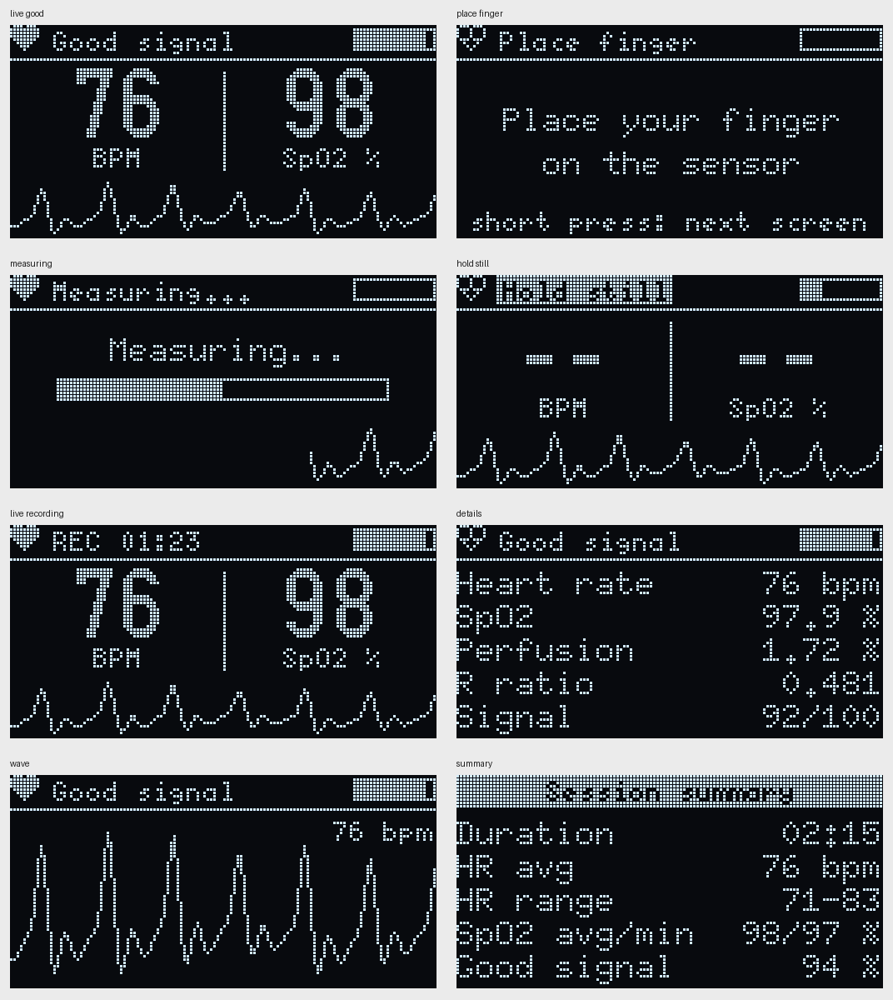
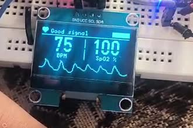
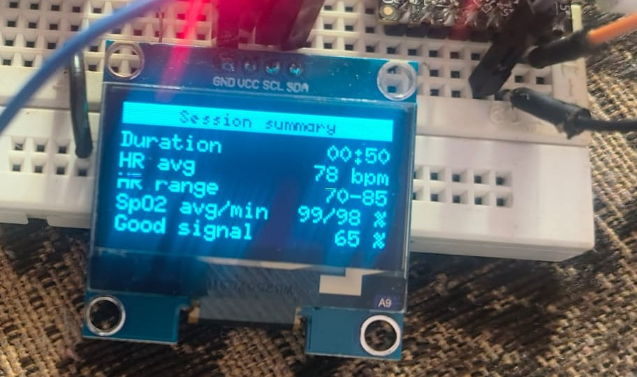
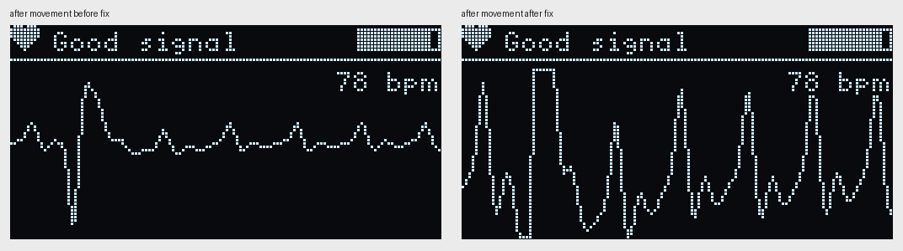

# Phase 4: OLED screens, button and signal quality

Code: `firmware/04_display/`. New files: `quality.h`, `session.h`, `ui.h`. `ppg_dsp.h` and `spo2.h` are from Phase 3 with two small changes (see below).

## Wiring

Same as before, plus one push button:

```
Button   one leg -> GPIO4, other leg -> GND     (uses the internal pull-up, no resistor needed)
```

The 1.3" OLED is an SH1106 (checked with a U8g2 test sketch first). It shares SDA/SCL with the sensor.

## Screens

Rendered on my PC with the real U8g2 code (`tests/render_screens.cpp`), so this is what the OLED should show:



- **Short press:** next screen (Live -> Details -> Wave -> Live)
- **Long press (0.8 s):** start a session. The top bar shows `REC mm:ss`. Long press again to stop, and a summary screen comes up. The summary is also printed to Serial as one `SESSION_CSV,...` line I can paste into a spreadsheet for the accuracy test in Phase 11.
- The heart in the corner fills in on every beat, and the bar on the right is the signal quality score.

## Signal quality

Before, the code always printed whatever number it had, even with the finger moving. Now `quality.h` decides if the numbers can be trusted:

| State | Shown as | When |
|---|---|---|
| No finger | "Place finger" | IR below 10,000 |
| Settling / searching | "Measuring..." + progress bar | first 2 s, then until the first BPM |
| Moving | "Hold still", values hidden | signal swings more than 1.5x a normal pulse, or ~2 beats in a row not found |
| Clipping | "Too bright", values hidden | raw value above 65,000 |
| Weak pulse | "Weak pulse", BPM shown, SpO2 hidden | PI under 0.5% (from Phase 3) |
| Good | values shown | everything else |

The score (0-100) is the share of the last 8 beats that were accepted, weighted by pulse strength (PI). BPM needs a score of 50, SpO2 needs 60.

### Two problems found while testing

**False "Hold still".** The first version also called it movement whenever a single beat was missed. In a simulation with uneven pulse heights (+-25%) and strong breathing, that gave "Hold still" 7% of the time with the finger perfectly still. Checking which rule fired: the size rule never did (biggest swing was 1.03x a normal pulse, limit 1.5x). It was single missed beats, where one smaller pulse falls under the threshold, which is normal. Now it needs about 2 beats in a row missing (2.5x the normal interval). False "Hold still" went to 0%, and a real bump is still caught after 0.08 s.

**Wrong first BPM after putting the finger back.** The session test showed a max heart rate of 85 when the simulated finger was always at 75. The first interval after re-placing the finger was sometimes way off (540 ms instead of ~800), and the Phase 2 start-up check allowed 30% difference, so it got through. In 3 of 10 runs the first BPM was about 10 BPM too high and took ~6 s to settle, which is probably what I saw on the real device in Phase 2. The check for the *first* BPM is now 15% (`IBI_START_JUMP`), the 30% rule for later beats is unchanged. First BPM is now within 2.7 BPM in all 10 runs.

Trade-off: someone with a lot of natural beat-to-beat variation (young people breathing slowly can have 10-15%) may wait a few beats longer for the first BPM.

## Timing: the sensor FIFO trap

The MAX30100 stores samples in a 16-sample FIFO (160 ms at 100 Hz). Reading the library code, it works out how many samples to read as

```
(write pointer - read pointer) & 15
```

If the FIFO is ever completely full, both pointers are equal, this gives 0, and it never reads again. The data just stops. So the loop must never be blocked for 160 ms, and drawing the OLED now takes time on the same I2C bus. What I did:

- the OLED is redrawn 25 times a second, sending only the parts that changed (see "Flicker" below), and the frame time is measured and printed in the Serial Monitor status line
- **watchdog:** if no samples arrive for 300 ms, the FIFO is reset and the measurement restarts, instead of freezing
- **Serial never waits:** with USB plugged in but no Serial Monitor open, each print can block for up to ~100 ms. `Serial.setTxTimeoutMs(0)` makes it drop the text instead

## Other changes to Phase 3 code

- `ppg_dsp.h`: `beatsMissing` flag added to the result (used by the quality code), and the stricter first-BPM check above
- `spo2.h`: no change

## Tests

All run on the PC with the simulated finger (`tests/sim_finger.h`):

| Test | Result |
|---|---|
| Finger still, 5 runs | values shown 100% of the time, 0% "Hold still" |
| Finger pressed for a moment | "Hold still" after 0.08 s, good again after 1.7 s |
| Red LED clipping | "Too bright" 100%, SpO2 never shown |
| Very weak pulse (PI 0.3%) | BPM shown, SpO2 hidden |
| Finger off for 5 s | nothing shown while off |
| 140 and 50 BPM | values shown, no false "Hold still" |
| Uneven pulse + strong breathing | 0% false "Hold still" (was 7%) |
| Session 30 s | HR avg 75.6, SpO2 avg 97.5, good 100% |
| Session with finger off 10 s | averages still right, good 49% |
| First BPM after finger put back, 10 runs | worst -2.7 BPM (was +10.3) |

The heart rate and SpO2 tests from Phases 2 and 3 still pass with the changed `ppg_dsp.h`.

I also compiled all four phase sketches for the real ESP32-C3 with arduino-cli (esp32 core 3.3.12, U8g2 2.36.19, MAX30100lib 1.2.1, all warnings on): no errors or warnings in my code. Phase 4 uses 27% of flash and 5% of RAM.

## Testing on real hardware

20 Oct 2026, three short videos and a photo, on the breadboard with a button on GPIO4.

 

What worked:
- all screens look like the PC renders, and the short press / long press work
- heart rate 72-80 BPM, matching what I got in Phases 2 and 3
- moving the finger straight away gives "Hold still" with the values hidden ("--"), and the Details screen drops the signal score to 30/100. After holding still it comes back
- a 50 s session: HR avg 78 (70-85), SpO2 avg/min 99/98, good signal 65%. The 65% is because I was moving my finger on purpose to test "Hold still"

### Problem: flat wave after moving the finger

On the Wave screen, after a movement the trace showed one big spike and then an almost flat line, even once the signal was fine again. The wave was scaled to the biggest value in the last 5 s, which was the movement spike, so the real pulse got squeezed flat until the spike scrolled off.

Fix (`ui.h`): every wave point is marked good or not (not good = recorded during settling, "Hold still" or "Too bright"). Only good points set the scale. The others are still drawn but clipped to the top/bottom edge. The scale also grows straight away but shrinks smoothly (15% per frame), so the wave doesn't suddenly change height when a tall peak scrolls out.



### "Flickering" in the videos

In the phone videos the screen seems to flicker a bit. Looking at the frames one by one, every 6th frame has horizontal strips of the picture missing (text broken into dashes, gaps in the wave). That's the camera, not the display: an OLED lights its 64 rows one after another about 100 times a second, the eye blends that into a steady picture, but the phone camera exposes the rows at slightly different moments and sometimes catches rows while they're off. Every OLED does this on video.

Things that really do change on the screen: the heart icon fills for 150 ms on each beat (on purpose), the status switches between "Hold still" and "Good signal" while the finger is moving slightly, and before the fix above the wave could suddenly change height.

### SpO2 shows 100

The Live screen often showed 100 while the Details screen showed 98.2-98.6 a bit later. With the textbook formula, any R below 0.40 gives 100% or more, and the Live screen caps it at 100. Single-beat R values on my finger go down to about 0.36 (Phase 3), so the median sometimes lands there. This is exactly why the formula needs calibrating against a real oximeter in Phase 11.

### Second test: Serial log and another video

Status line: **frame 32-34 ms, FIFO resets 0** the whole time. So drawing the OLED took a third of each 100 ms, and the sensor reading never stalled.

**Flicker, measured.** I measured the OLED brightness in every frame of the video (1,212 frames at 30 fps). The brightness change at 10 Hz (the screen update rate) was 0.08%, and at 5 Hz 0.09%. That's far too small to see, so the screen brightness does not flicker. What does look like flicker is movement: the wave got a new point every 40 ms but the screen was only redrawn every 100 ms, so the wave jumped 2-3 pixels at a time, 10 times a second. The quality bar also jumped by 12 points at a time.

**Fix: 25 fps, only send what changed.** The SH1106 is split into 8 pages (strips of 8 rows). Sending all 8 takes ~33 ms, too slow for 25 fps. But most of the screen doesn't change between frames, so now the code keeps a copy of what was last sent and only sends pages that are different (`updateDisplayArea`), plus a full refresh every 5 s just in case. A new frame is drawn each time a new wave point arrives, so the wave scrolls exactly 1 pixel per frame. The quality bar now slides to its new value instead of jumping.

Estimated with the real drawing code on the simulated finger (`tests/frame_cost.cpp`, using 33 ms / 8 = ~4.1 ms per page):

| Screen | Pages changed per frame | Time per frame | I2C busy at 25 fps |
|---|---|---|---|
| Live | 3.1 of 8 | ~13 ms | ~32% |
| Details | 0.3 of 8 | ~1 ms | ~3% |
| Wave | 6.1 of 8 | ~25 ms | ~63% |

So the Live screen at 25 fps uses the bus about as much as the old 10 fps full redraw did. The status line now also shows fps and pages per frame, to check this on the real board.

**Beat intervals less steady than in Phase 3.** Running `validation/ibi_check.py` on the log:

| | Phase 4 log (OLED, filming, pressing the button) | Phase 3 log (no OLED) |
|---|---|---|
| Short-long pairs | 5 | 0 |
| Rejected beats | 12 of 72 | 0 of 15 |
| Average change between intervals | 132 ms | 28 ms |

A short interval followed by a long one that add up to about two normal beats means one beat was detected early. Possible reasons: the finger moving slightly (I was holding the phone and pressing the button), the OLED disturbing the sensor electrically (it draws current in bursts on the same 3.3V), or real early heartbeats, which are common. One recording can't tell these apart. Next test: 2 minutes with the Phase 3 sketch and 2 minutes with the Phase 4 sketch, hand completely still, not filming, not touching the button, then `ibi_check.py` on both. This matters for Phase 5, because HRV is calculated from exactly these intervals.

### Third test: hand still, Phase 3 vs Phase 4

20 Oct 2026. 2 minutes each, hand resting on the table, not filming, not touching the button. Recorded with `validation/capture_serial.py`, checked with `validation/ibi_check.py`. Raw logs: `validation/logs/phase3.txt` and `phase4.txt`.

| | Phase 3 (no OLED) | Phase 4 (OLED at 25 fps) |
|---|---|---|
| Intervals | 132 | 137 |
| Rejected | 1 (0.8%) | 7 (5.1%) |
| Short-long pairs | 0 | 1 |
| Median | 860 ms (69.8 BPM) | 880 ms (68.2 BPM) |
| Average change between intervals | 32 ms | 47 ms |

What this tells me:
- The messy intervals in the second test (5 short-long pairs, 132 ms average change) were mostly from moving while filming and pressing the button. Holding still, Phase 4 is close to Phase 3.
- Phase 4 is still a bit worse (7 vs 1 rejected, 47 vs 32 ms). For the rejected beats that's a Fisher exact test p = 0.067, so it could be chance, and two separate 2-minute recordings naturally differ (breathing, how relaxed I was). If the OLED does disturb the sensor, the effect is small.
- This matters most for HRV in Phase 5, which uses exactly these intervals. So Phase 5 will filter out odd intervals the standard way, and I can repeat this comparison there with more recordings.

25 fps version on the real board (status line): **25.0 fps, 3.3 pages per frame, frame 15 ms** (max 34 ms, that's the full refresh every 5 s), **FIFO resets 0**. The estimate from `frame_cost.cpp` was 3.1 pages and ~13 ms, so it was close. The wave now scrolls smoothly.
