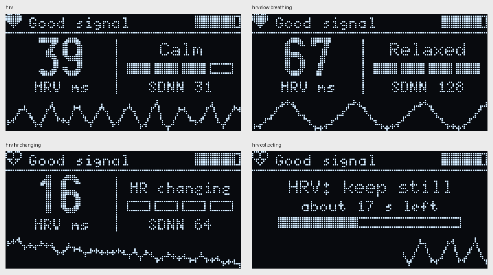

# Phase 5: heart rate variability (HRV) and stress level

Code: `firmware/05_hrv/`. New file `hrv.h`. Changed: `ppg_dsp.h` (beat timing), `ui.h` (HRV screen), `session.h` (HRV in the summary).

## What HRV is

The heart doesn't beat like a metronome. At rest the gap between beats gets a little shorter when breathing in and longer when breathing out, plus other small changes. That variation is mostly controlled by the parasympathetic ("rest and digest") nervous system, so it's usually higher when relaxed and lower when stressed, tired or ill.

PulseLab works it out from the beat-to-beat intervals it already measures, over the last 60 s:

- **RMSSD**: root mean square of the differences between neighbouring intervals. The standard short-term HRV number.
- **SDNN**: standard deviation of the intervals.
- **pNN50**: % of neighbouring intervals that differ by more than 50 ms.

Standard HRV recordings are 5 minutes (Task Force of the European Society of Cardiology and NASPE, 1996, [ref 5](REFERENCES.md)). One-minute RMSSD is a common shorter version, used by many wearables, but it's noisier ([ref 7](REFERENCES.md)).

## Step 1: timing beats more precisely

Until now each beat was rounded to the nearest sample, so to a 10 ms grid. That's fine for BPM but adds noise to HRV. I measured it with the simulated finger, comparing RMSSD from the detected beats with RMSSD from the simulator's true beats:

| Beat-to-beat variation | True RMSSD | Before | After |
|---|---|---|---|
| 0.5% | 5.6 ms | 9.0 (+61%) | 5.6 (+0.4%) |
| 1% | 11.7 ms | 13.2 (+13%) | 11.7 (+0.2%) |
| 3% | 35.9 ms | 37.4 (+4%) | 36.0 (+0.1%) |
| 6% | 68.0 ms | 69.1 (+2%) | 68.1 (+0.3%) |

The fix: the beat is found at the peak of the slope, so a parabola is fitted through the 3 slope values around the peak, and its top gives the beat time to a fraction of a sample. The error per interval went from about 4 ms to 0.5 ms. With a weak, noisy signal it still helps (at 1% variation: +23% error before, +11% after).

This matters most when HRV is low, which is exactly when someone is stressed.

## Step 2: cleaning the intervals

HRV is very sensitive to wrong intervals. In the test below, one early beat (560 ms then 1040 ms in a normal ~800 ms rhythm) would have pushed RMSSD from 36 to 77 ms. So before calculating:

- only intervals recorded while the signal is good are used. Intervals the heart rate code rejected, or recorded during "Measuring...", "Hold still" or "Too bright", are dropped and leave a gap
- an interval more than 20% away from the median of its neighbours (2 before, itself, 2 after) is marked as an artifact
- differences are only taken between two normal intervals that come directly after each other, never across a gap
- each interval waits until 2 more beats have arrived before being used. If the signal goes bad in that time, the waiting ones are thrown away. That handles the fake last interval when the finger is lifted, which I saw in Phase 3

HRV is shown after 30 s of clean intervals (and at least 20 pairs).

The first version compared each interval with the median of the last 7 normal ones and also used intervals from "Measuring...". Both were wrong, see "First real test" below.

## Step 3: is the heart rate steady?

RMSSD only says something about relaxation when the heart rate is steady. If it is rising or falling (after climbing stairs, or while breathing fast) the intervals change anyway, and RMSSD measures that instead. So the code compares the average interval in the first 20 s and the last 20 s of the window. If they differ by more than 12%, it still shows RMSSD but no stress level, just "HR changing".

## Stress level

From RMSSD, as a rough guide:

| RMSSD | Shown as |
|---|---|
| 60 ms or more | Relaxed |
| 35-60 ms | Calm |
| 20-35 ms | Some stress |
| under 20 ms | High stress |

These are rough ranges for resting adults, not a medical or validated stress measure. HRV also depends on age, fitness, breathing, posture, caffeine and time of day. Comparing the same person in the same conditions ([ref 6](REFERENCES.md) has typical values) (before and after slow breathing, for example) says much more than these fixed numbers.

## Screen

The HRV screen (second one) shows RMSSD, the stress level with a 4-step gauge, SDNN, and the beat-to-beat intervals as a graph, one dot per beat. When relaxed and breathing normally, that graph usually shows slow waves: the heart speeding up on each breath in and slowing down on each breath out.

Sitting normally, slow breathing (big slow waves in the graph), heart rate rising (no level, empty gauge), and still collecting.

Button order is now Live -> HRV -> Details -> Wave. The session summary has a 6th line with HRV, and the `SESSION_CSV` line has RMSSD as its last column.

The HRV screen only changes once per beat, so it uses about 3% of the I2C bus (`tests/frame_cost.cpp`). That's useful, since in Phase 4 it looked like the OLED might disturb the sensor a little.

## Tests

`tests/test_hrv.cpp`:

| Test | Result |
|---|---|
| Steady 800 ms | RMSSD 0, SDNN 0, HR 75 |
| Alternating 780/820 ms | RMSSD exactly 40, SDNN 20 |
| Random intervals vs a plain reference calculation | identical (43.17 / 30.21) |
| One early beat in a breathing rhythm | 36.4 ms (36.1 without it, 77.2 if not cleaned) |
| Gap between two different steady parts | no difference taken across it |
| Only the last 60 s count | old part forgotten |
| Not shown before 30 s | ready after 32 s |
| Fake 700 ms interval right before "Hold still" | never used (would have given 11.8 ms) |
| Whole chain on the simulated finger | 11.8 vs 11.5 true, 34.5 vs 35.0, 68.9 vs 68.8 |
| Slow breathing, 6/min, heart rate swinging +-15/25/35% | 43.5 vs 43.5 true, 70.6 vs 70.9, 96.8 vs 95.9 |
| Heart rate rising from 65 to 100 BPM | "HR changing", no stress level |
| Wrong intervals while "Measuring..." at the start | not used, HRV ready on time |

`tests/test_heart_rate.cpp` got two new tests for the second bump: a late second bump gives 0% wrong BPM (40% before the fix, up to 2.6x the true rate), and a real 160 BPM is still measured within 2.5 BPM.

All the earlier heart rate, SpO2 and quality tests still pass with the new beat timing.

### My earlier recordings, replayed

`tests/replay_log.cpp` feeds a recorded Serial log through the HRV code. My two 2-minute recordings from Phase 4 (recorded before the better beat timing, so intervals are rounded to 10 ms):

| | Phase 3 log (no OLED) | Phase 4 log (OLED) |
|---|---|---|
| RMSSD at the end | 38.9 ms | 48.8 ms |
| Artifacts removed | 0% | 10% |
| Stress level | Calm | Calm |

## First real test (and what was wrong)

I recorded two logs with `validation/capture_serial.py` (`validation/logs/hrv_normal.txt` and `hrv_slow.txt`). In the "normal" one I breathed fast for a while to push my heart rate up; in the "slow" one I breathed slowly, about 5 s in and 5 s out. Three things went wrong.

**1. HRV stuck at 5% for about a minute.** The first intervals after placing my finger were junk (327, 311, 963 ms, while the signal was still "Measuring..."). They went into the reference median of the artifact check, so every real interval after them looked wrong and was thrown out. Fix: only use intervals from a good signal, and compare each interval with its neighbours on both sides instead of only past ones. Then a few bad intervals at the start can't block everything after them.

**2. Slow breathing broke the heart rate code.** With slow deep breathing my heart rate swung a lot: intervals went from about 700 to over 1000 ms within one breath. The heart rate code (from Phase 2) rejected anything more than 20% from the median, so 15 real long intervals were rejected, it went back to "Measuring" 4 times, and then it found fake short beats (328, 379, 388 ms) instead. So the slow breathing recording had less clean data than the normal one, which is the opposite of what should happen.

Fix in `ppg_dsp.h`:
- the accepted range around the median is now 0.70-1.45x instead of +-20%, wider on the long side, because a missed beat gives 2x but slowing down never jumps that far
- an interval is also accepted if it is within 25% of the previous interval (and 0.55-1.8x the median). Breathing changes the rate smoothly from beat to beat; a missed or extra beat jumps
- if 3 rejected intervals in a row agree with each other (within 20%), the rate has really changed, so they are taken as the new rhythm instead of starting over with "Measuring"

On the simulated finger with slow breathing (6/min, heart rate swinging +-25%): rejected intervals went from 36 to 1, restarts from 12 to 0, and RMSSD from 43 ms to 70.6 ms (true value 71 ms).

**3. Fast breathing showed "Relaxed".** While my heart rate was going up, RMSSD went up as well, so it said relaxed when I wasn't. That's why I added the steady check (Step 3).

**4. (Found after the fix) Heart rate jumping to 140-160 BPM.** The more relaxed rules from fix 2 let the code lock onto the second bump of each pulse, which in my signal comes 300-400 ms after the beat. Fixed by skipping early peaks that are much smaller than the beat before them, and by never taking on a new rate near half or double the old one. Details in DEBUG_LOG #12.

**Also:** a few lines in the log were split in two (`BPM  8` and `8.7` on the next line). The recorder wrote whatever arrived in one read. It now waits for the end of the line.

My two logs replayed through the fixed code (`replay_log ... all`, which uses every interval, including the ones the old code rejected):

| | Breathing fast for a while | Slow breathing |
|---|---|---|
| RMSSD (ms) | 39-54 | 68-71 at the end (85-96 earlier*) |
| SDNN (ms) | 69-121 | 100-157 |
| Heart rate | rose from 71 to 87 BPM | about 74 BPM, steady |
| Shown as | "HR changing" for most of it | Relaxed |

\* The earlier part still has the fake short beats from the old code in it (24% artifacts at 41 s, 1% at the end). With the fixed code they shouldn't happen in the first place.

Slow breathing gives clearly higher HRV than my sitting recordings from Phase 3/4 (39-49 ms, Calm), which is what's expected. But this is a replay of logs from the old code, so it has to be checked again on the device.

## Testing on real hardware

With the fixed code (both fixes, #11 and #12 in the debug log), 20 Oct 2026. Two recordings of about 2.5 minutes each, recorded with `validation/capture_serial.py`: `validation/logs/hrv_sit2.txt` (sitting still, breathing normally) and `hrv_slow2.txt` (breathing slowly, about 5 s in and 5 s out).

| | RMSSD (ms) | SDNN (ms) | Level | Heart rate | Rejected intervals |
|---|---|---|---|---|---|
| Sitting normally | 49 at first, settling to 35-37 | 38 | Calm | 69-80 BPM, steady | 1 (at the very start) |
| Slow breathing | 87 at first, then 53-62 | 89 | Relaxed (Calm for ~30 s) | swinging 65-87 BPM with each breath | 7, all in the first 25 s while I was still getting my finger steady |

- Slow breathing gives clearly higher HRV than sitting normally: about 60 vs 36 ms at the end, and SDNN more than double. That's what should happen, since slow breathing makes the heart speed up and slow down a lot more with each breath.
- The heart rate never jumped to double. No second bumps were skipped in these two recordings (the `h` values show no early small peaks), so on this day my second bump stayed under the threshold anyway.
- Only one "HR changing" in the slow recording, for one beat.
- The first value after "HRV ready" is the highest in both recordings (49 and 87). The first 30 s include the time when I had just placed my finger and was settling down. It drops as the window moves on.

One thing I looked at: in the slow recording a 377 ms interval was accepted while the screen said "Hold still" (lines 30-31). It's a false beat, let in by the "smooth change" rule, which allows intervals down to 0.55x the median. In all six of my recordings a real interval on a good signal never went below 0.71x the median, so I tried 0.60-0.65. But then the simulator test with very deep breathing (heart rate swinging +-35%) failed: real short beats were rejected and the BPM restarted up to 6 times. Since the 377 happened during "Hold still", the BPM was hidden and HRV ignored it anyway, so I kept 0.55. Phase 7 (guided slow breathing) needs the deep-breathing case to work.

SpO2 was 93-94% in the sitting recording (R about 0.66) and 95-97% in the slow one (R about 0.55), lower than in Phase 3 (97.6-98.4%, R 0.47). The SpO2 formula isn't calibrated yet and R seems to change with how the finger sits on the sensor. That's for Phase 11, with a real pulse oximeter next to it.

Why slow breathing raises HRV this much: around 6 breaths a minute the breathing and the heart rate control loop (baroreflex) fall into step, so the heart rate swings much more with each breath ([ref 8](REFERENCES.md), resonance breathing).
