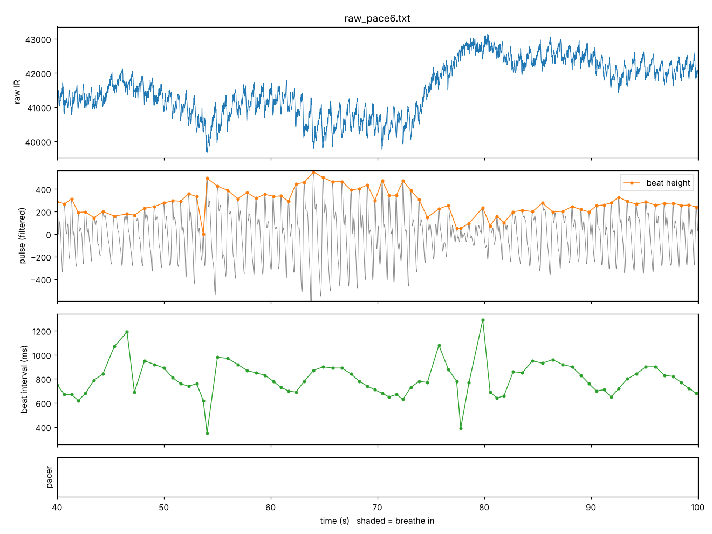
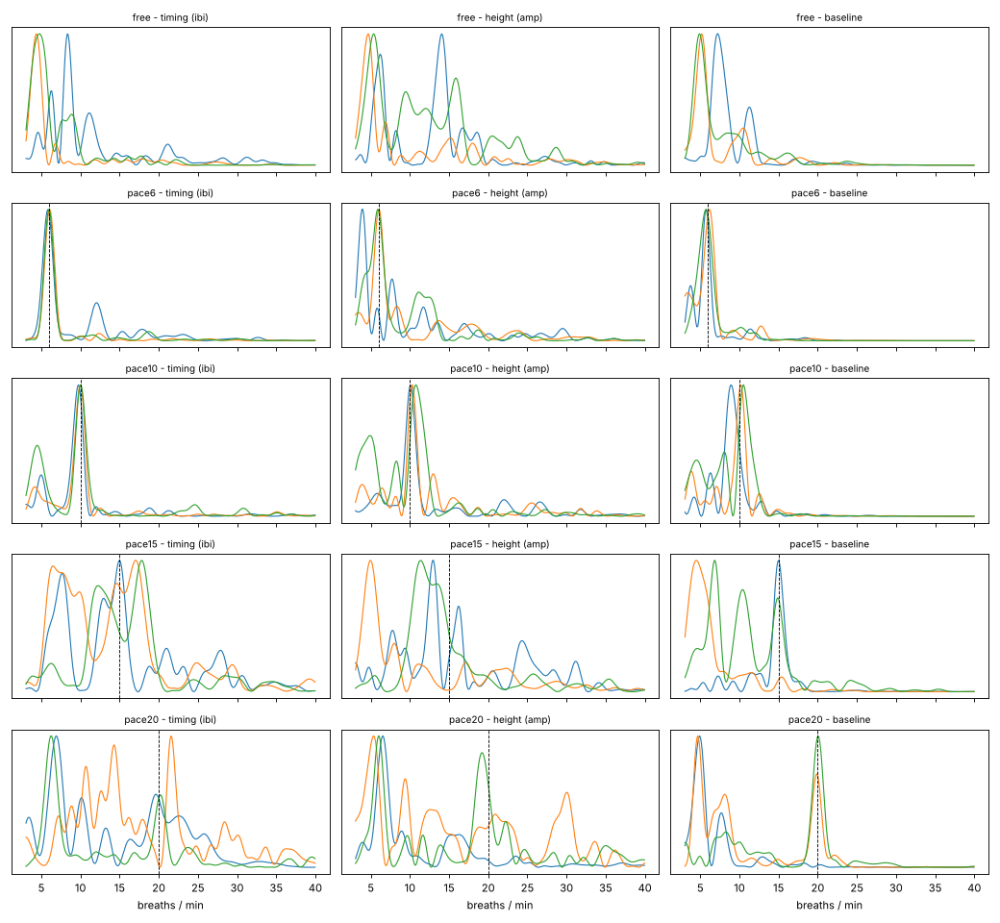
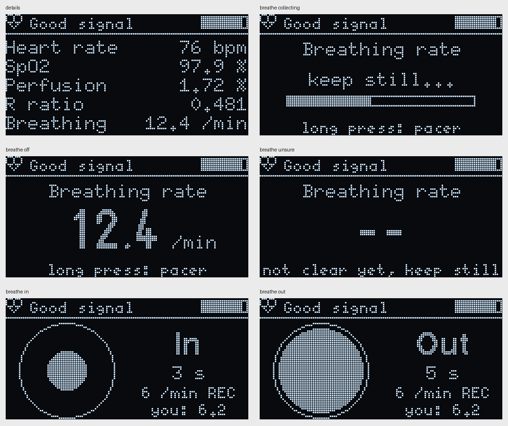

# Phase 6: breathing rate

Code: `firmware/06_breathing/`. New: `breathing.h` (breathing rate), `pacer.h` (breathing pacer), the Breathe screen in `ui.h`, raw recording mode (`SERIAL_MODE 3`).

Status: runs on the device. On my recordings, every rate it showed was within 2 /min of the pacer (6, 10, 15, 20 /min), and my free breathing matched my own count (~32 /min).

## The idea

The goal is breaths per minute from the same finger sensor, with no extra sensor on the chest. Breathing changes the PPG signal in three ways ([Allen 2007, Karlen 2013](REFERENCES.md)):

| Effect | What happens | Why |
|---|---|---|
| Timing | beats come faster while breathing in, slower while breathing out | the same heart rate swing that HRV measures (respiratory sinus arrhythmia) |
| Pulse height | each beat gets a bit bigger or smaller with each breath | breathing changes the pressure in the chest, so the heart pumps a bit differently |
| Baseline | the IR level drifts up and down | breathing changes how much blood is in the veins of the finger |

None of them is reliable on its own. Karlen et al. (2013, [ref 9](REFERENCES.md)) estimate the rate from each one and only report a number when they agree ("smart fusion"). PulseLab does the same, with a few changes I had to make for my signal (below).

## Step 1: recording real data first

In Phase 5 my simulator was too gentle, and only my real recordings showed the problems (DEBUG_LOG #11 and #12). So this time I recorded real data first and built the breathing code on it.

**Raw recording mode.** With `#define SERIAL_MODE 3` the board sends every sensor sample as one line, `index,ir,red`, 100 times a second (about 2 KB/s). The index shows if any were lost. Lines starting with `#` are notes (pace changes, FIFO resets, status, and the device's own breathing estimates).

**Breathing pacer.** To check a breathing rate I need to know the true one. Counting my own breaths while breathing normally doesn't work well, so the device tells me when to breathe instead: a circle grows while breathing in (40% of each breath) and shrinks while breathing out. A long press on the Breathe screen changes it: off -> 6 -> 10 -> 15 -> 20 per minute. The pacer counts sensor samples, not `millis()`, so it lines up exactly with the data.

**Recordings** (`validation/logs/raw_*.txt`, 150 s each, 0 samples lost):

| File | Pacer | Avg heart rate | Note |
|---|---|---|---|
| raw_free.txt | off | 74 | breathing normally, not counted |
| raw_pace6.txt | 6 /min | 77 | |
| raw_pace10.txt | 10 /min | 88 | |
| raw_pace15.txt | 15 /min | 115 | recorded right after coming in from outside |
| raw_pace20.txt | 20 /min | 111 | same, and one sensor FIFO reset in the middle |

The first three were recorded in one sitting, the last two later, after coming in from outside, so the heart rate was much higher and still coming down.

Here's 60 s of the 6 /min recording (`validation/plot_raw.py`). The beat intervals clearly go up and down about every 10 s, and the pulse height and baseline move too, though less regularly:



## Step 2: what's in the signal

For each beat, `BeatFeatureTracker` measures the interval, the pulse height (max - min of the filtered signal) and the average raw IR over the beat. Only beats from a good signal with a valid interval are used. These come at irregular times, so they're turned into evenly spaced series at 4 Hz by drawing straight lines between good beats.

The spectrum of each series, for three 60 s windows per recording (dashed line = the pacer):



- At 6 and 10 /min there's one clean, sharp peak in all three, right at the pacer.
- At 15 and 20 /min (high heart rate) the baseline still shows the breathing peak clearly, but timing and height are messy. The breathing effect on the heart rate gets weaker at higher heart rates.
- Everywhere there's a lot of slow stuff below about 8 /min. Part of it is the heart rate still settling, part is probably the ~0.1 Hz blood pressure waves ("Mayer waves") that every body has. In the free breathing recording this slow part is the biggest thing in all three series.

## Step 3: choosing the method (on the PC first)

I tried the methods compared by Charlton et al. ([ref 10](REFERENCES.md)) in Python on these recordings, with sliding 60 s windows every 5 s:

| Method | 6 /min | 10 /min | 15 /min | 20 /min |
|---|---|---|---|---|
| Strongest frequency (FFT), each series | very good | very good | picks the slow junk | picks the slow junk |
| Counting breaths in the filtered series | counts too many | ok (baseline) | ok (baseline) | ok |
| FFT, the 3 spectra added, slow frequencies weighted down | very good | very good | good when shown | good when shown |

Then a small search over the settings (window 45/60 s, how much to weight down slow frequencies, filter, how to combine). First choice: 60 s window, a 0.08-0.6 Hz band-pass, power weighted by frequency, the 3 spectra each scaled to sum 1 and added. (Step 5 changed the band and the weighting after my count.) With only 5 recordings there's a real risk of tuning to them, so I avoided odd numbers that only happen to fit, and the next recordings will be the real check.

### On the ESP32

The ESP32-C3 has no floating point unit, so a full FFT plus filtering every 5 s would be slow. Instead `breathing.h` computes the power only at the 141 frequencies needed (5 to 40 breaths/min in 0.25 steps) with the Goertzel algorithm, and applies the band-pass filter as a weight on those frequencies (its response, squared twice, is the same as filtering forwards and backwards). I checked in Python that this gives the same results as the full version. The work is split into 9 small steps, one per `loop()`, so the sensor FIFO (full after 160 ms) is never at risk. The status line prints the longest step: **25 ms** on my board (with 121 frequencies), and the device's own estimates (`# breathing` notes) matched the PC replay exactly.

## Step 4: a problem with "agree" (found by a test)

The first rule was "show the rate if at least 2 of the 3 series agree within 3 /min". It was right on every paced recording. But a simulator test with **no breathing at all**, only random beat-to-beat noise, still showed a rate 62% of the time.

The reason: on noise it was always height and baseline that agreed. In my measurement a deeper pulse also lowers the average IR of that beat, so those two are partly the same thing, and they "confirm" each other. (I tried measuring the baseline at the foot of each pulse instead, like Karlen; it made the 15 /min recording worse and didn't fix the noise case, so I went back.)

New rule. A rate is shown only if:
- the **timing** series and at least one other agree, or all 3 agree (timing comes from when the beat happens, not from how big it is, so it's independent of the other two), **and**
- at least 30% of the combined power is within +-2 /min of the peak, so it's one clear peak and not a flat, noisy spectrum.

| Rule | Real recordings: shown | Real: right when shown | Pure noise: shown |
|---|---|---|---|
| any 2 agree | 80% | 100% | 62% |
| timing + 1 more (or all 3), and 30% peak share | 75% | 100% | 20% |

It's not zero on pure noise: sometimes random noise really does look like a rhythm for a minute. But it's 3 times less, for very little loss on real data. (After step 5 it's 10%.)

## Step 5: I was breathing faster than the code allowed for

For the free breathing test (`raw_free2.txt`, after eating, heart rate ~83) I counted my breaths: about 80 in 150 s, so **~32 /min**. One breath = in + out. The device showed "--" the whole time.

The breathing was there: from about 117 s the timing series had its peak at 31-33 /min, and at the end the baseline too. But:
- I had set the search range to 5-35 /min and the band-pass to 0.08-0.6 Hz (= 36 /min), from "typical resting rates". At 32 /min the filter weight was already turning the peak down.
- At 32 /min one breath is under 2 s, only about 2.5 heartbeats. The beat intervals just zig-zag, so the timing effect is small, and the slow drift (7-9 /min) won.

Change: search 5-40 /min, band-pass 0.08-0.8 Hz (48 /min), and slow frequencies weighted down more (power x f^1.5 instead of f^1). I checked every combination of those three on all 6 recordings and the simulator:

| Setting | Paced: shown | Paced: right | Free 32 /min: shown | Pure noise: shown | Simulator 6-36 /min: shown |
|---|---|---|---|---|---|
| before (35, 0.6 Hz, f^1) | 75% | 100% | 0 of 17 | 20% | 79% |
| after (40, 0.8 Hz, f^1.5) | 63% | 100% | 11 of 17 (29.3-32.4) | 10% | 92% |

The cost is fewer estimates at 6 /min (88% -> 62% shown), because slow frequencies are weighted down more. I'm OK with that: in Phase 7 the device sets the slow pace itself, so it doesn't have to measure it then.

There's a risk of tuning to my own few recordings here, so these numbers need checking on new recordings, ideally from other people too.

## Results

`tests/replay_raw.cpp` runs the recordings through the exact device code. An estimate every 5 s after the first 60 s of good signal:

| Recording | True rate | Estimates | Shown | Within 2 /min | Median | Mean error |
|---|---|---|---|---|---|---|
| raw_pace6 | 6 (pacer) | 16 | 62% | 100% | 6.3 | 0.3 |
| raw_pace10 | 10 (pacer) | 16 | 100% | 100% | 10.1 | 0.2 |
| raw_pace15 | 15 (pacer) | 16 | 12% | 100% | 15.2 | 0.2 |
| raw_pace20 | 20 (pacer) | 12 | 83% | 100% | 20.1 | 0.1 |
| raw_free2 | ~32 (my count) | 17 | 65% | 10 of 11 (all within 3) | 31.3 | |
| raw_free | not counted | 16 | 6% | | 8.6 | |

- Every rate shown on the paced recordings was within 2 /min of the pacer, the target in the roadmap. My count for free2 is only roughly right, so within 3 is the fair check there.
- 15 /min was mostly "--". Right after coming in, my heart rate was ~115 and still dropping, and around 80 s my finger moved. After that the 3 series didn't agree, so it said nothing. That's the right behaviour.
- The first free recording now shows almost nothing (it used to show ~8.5 /min). That ~8.5 was probably the ~0.1 Hz blood pressure wave, not my breathing, which the stronger weighting now ignores. I can't be sure, I didn't count that time.

## The screens



- **Breathe screen, pacer off:** the measured breathing rate, big. While the first 60 s are collected it shows a progress bar. When the 3 series don't agree it shows "--" and "not clear yet, keep still".
- **Breathe screen, pacer on:** the circle, "In"/"Out" with a countdown, the pace, and "you: 6.2" (the measured rate), so you can see if it follows.
- **Details screen:** "Breathing" replaced "Signal" (the signal score is already the bar at the top).
- **Serial Monitor (mode 2):** each beat line has `Resp 12.3` (or `Resp -- (45%)`).
- **Raw mode (3):** a `# breathing ...` note at every estimate.

## Tests

`tests/test_breathing.cpp`:

| Test | Result |
|---|---|
| 1-3. Pacer order, exact timing at 6/10/15/20, restart on change | pass |
| 4. Simulated finger, all 3 effects, 6 to 36 /min | shown 100%, all within 2, mean error 0.01-0.24 |
| 5. Only the baseline effect | shown 4 of 16, all right (no wrong rate) |
| 6. No breathing at all, 8 runs | shown 10% (62% with the first rule, 20% before step 5) |
| 7. Finger lifted for 5 s | starts collecting again from 0 |
| 8. My 4 paced recordings | all shown estimates within 2 /min |
| 9. My free breathing, counted ~32 /min | shown 11 of 17, all within 3 of the count |

The simulator got a new setting for the pulse height effect (`breathAmp` in `sim_finger.h`). All earlier tests pass with the Phase 6 code.

## One FIFO reset

The 20 /min recording has one `# fifo reset`: the loop didn't read the sensor for more than 300 ms once in about 12 minutes of recording. That was with the earlier firmware (no breathing code yet), so it's not the breathing code. I don't know the cause yet; maybe a slow moment on the USB side. The new status line also prints how long the longest breathing step took, to keep an eye on it.

## How to record

1. Upload `firmware/06_breathing` (set to `SERIAL_MODE 3`). Tools > USB CDC On Boot must be Enabled, otherwise the build now stops with an error (DEBUG_LOG #13).
2. Close the Arduino Serial Monitor / Plotter.
3. Sit at a table, arm resting, finger on the sensor with light pressure.
4. Start the recorder first, then set the pace with long presses on the Breathe screen, so the `# pace` note gets into the file. (If you forget, `replay_raw` takes the pace from a file name like `raw_pace10.txt`.)

```
python validation/capture_serial.py COM9 validation/logs/raw_free2.txt 150
python validation/plot_raw.py validation/logs/raw_free2.txt 30 90
g++ -std=c++17 -O2 -I firmware/06_breathing tests/replay_raw.cpp -o replay_raw
./replay_raw validation/logs/raw_free2.txt resp
```
