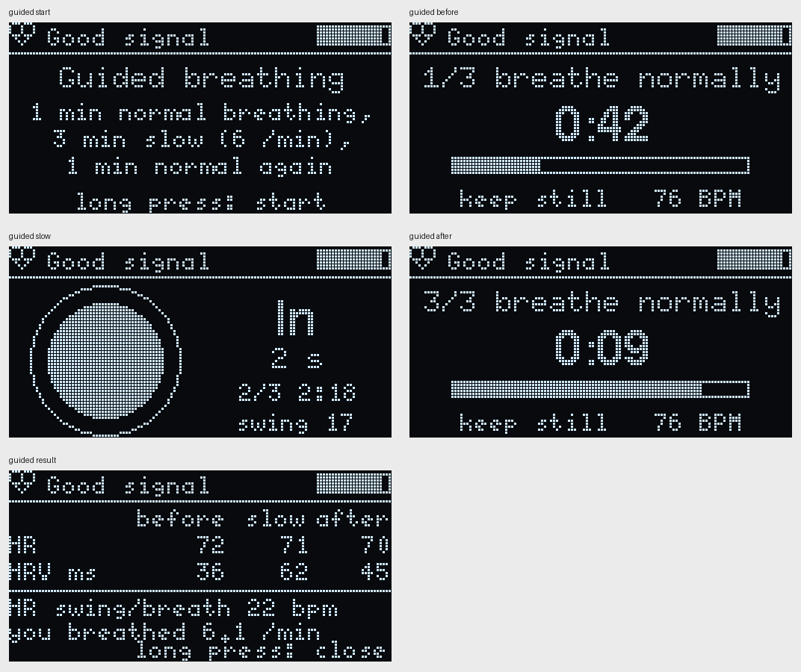
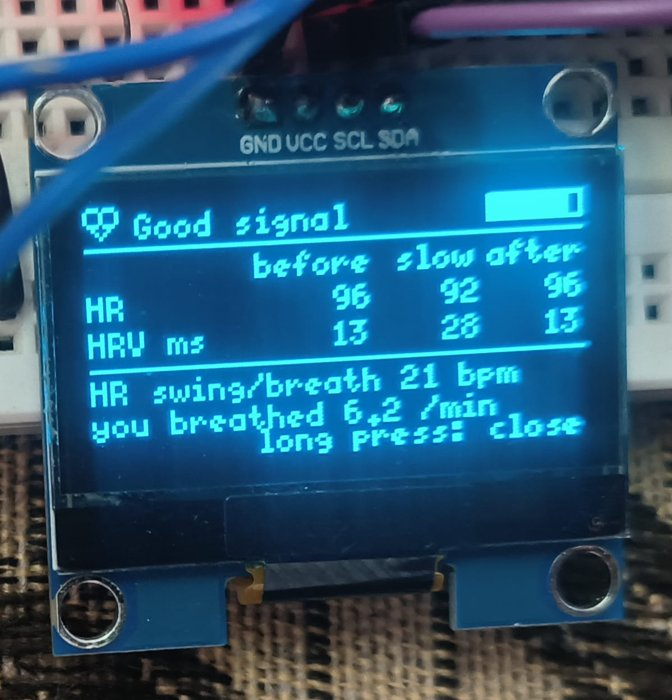
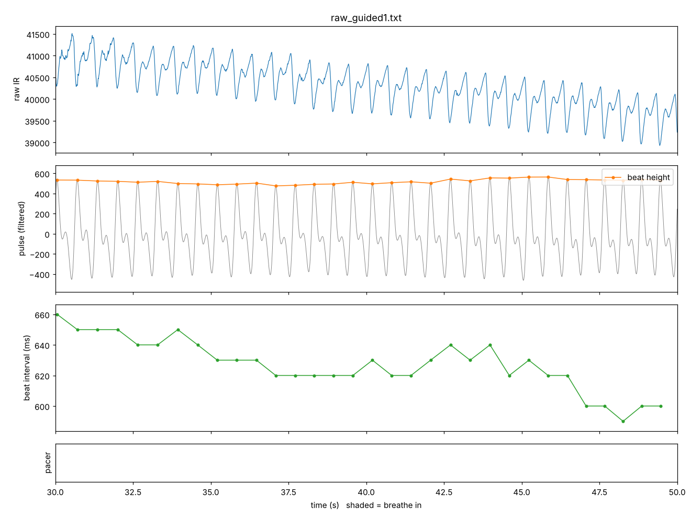

# Phase 7: guided breathing

Code: `firmware/07_guided/`. New: `guided.h` (the session), the Guided screen in `ui.h`.

Status: works on the device. In my first session, slow breathing doubled my HRV (13 -> 28 ms), and the PC replay of the recording gives exactly the same result as the device.

## The idea

In Phase 5 my HRV went from about 36 ms sitting to about 60 ms when breathing slowly. That's not a coincidence: at about 6 breaths a minute, the breathing and the body's own blood pressure rhythm (about 0.1 Hz, the "Mayer waves" from Phase 6) line up. The heart rate then swings much more with each breath. This is called resonance breathing, and it's the basis of HRV biofeedback training ([Lehrer & Gevirtz 2014, ref 8](REFERENCES.md)).

So Phase 7 turns the pacer into a short guided exercise that shows the effect on yourself:

| Part | Length | What you do | What's measured |
|---|---|---|---|
| 1. Before | 1 min | breathe normally | heart rate, HRV |
| 2. Slow | 3 min | breathe with the circle, 6 per minute (4 s in, 6 s out) | heart rate, HRV, heart rate swing per breath, breathing rate |
| 3. After | 1 min | breathe normally again | heart rate, HRV |
| Result | | | before / slow / after side by side |



(The numbers on the result screen in this picture are made-up examples for the layout, not a measurement.)

## How it works

`GuidedSession` in `guided.h` is a small state machine, called once per sensor sample like the rest of the code:

- **Time** is counted in samples, so the parts are exactly 60 / 180 / 60 s.
- **Each part gets its own HRV.** The session has its own `HrvAnalyzer`, which is reset at the start of every part. So "before" only uses beats from the before part, and so on. It uses the same cleaning as Phase 5 (good signal only, artifact check, gaps). The main HRV screen keeps working as before.
- **Heart rate per part:** the average of the good beat intervals in that part.
- **Swing per breath** (slow part only): for each 10 s breath of the pacer, the highest minus the lowest heart rate (from the beat intervals) in that breath. This "peak minus trough" is the usual way HRV breathing training shows how well it's working. The first 2 breaths are skipped (getting into the rhythm), and a breath only counts if it has at least 3 good beats and no bad ones.
- **"You breathed"**: the last valid breathing rate from the Phase 6 code during the slow part, to see if you actually followed the circle.
- **Finger lifted:** the session pauses (time stops, "paused: place your finger") and carries on when the finger is back. The breath that was interrupted isn't counted.

### Buttons

- Short press goes through the screens: Live -> HRV -> Breathe -> **Guided** -> Details -> Wave.
- Long press on the Guided screen starts a session (only with a finger on the sensor).
- During a session the screen stays on Guided, and short presses do nothing, so a session can't be left by accident. A long press cancels.
- On the result screen, a long press closes it.

### Serial

- `SERIAL_MODE 2`: `[Guided: before]` etc. at each part, and at the end one line for a spreadsheet:
  `GUIDED_CSV, slow seconds, HR before, HR slow, HR after, RMSSD before, RMSSD slow, RMSSD after, swing, swing breaths, breathing rate`
- `SERIAL_MODE 3` (raw recording): the same as `#` notes, plus `# pace 6` / `# pace 0` notes, so `replay_raw` knows the true breathing rate in each part. `replay_raw` also runs the session again on the PC from the `# guided before` note and prints its own `GUIDED_CSV`, to compare with the device's.

The Guided screen changes about 1 of the 8 OLED pages per frame (10% of the I2C bus, `tests/frame_cost.cpp`), the same as the Breathe screen.

## Tests

`tests/test_guided.cpp`:

| Test | Result |
|---|---|
| 1. Part timing | slow from 60.00 s, after from 240.00 s, done at 300.00 s |
| 2. Finger lifted for 10 s in the slow part | paused 10.1 s, done at 310.1 s |
| 3. Swing vs the simulator's true heart rate swing | 9.2 vs 9.2 BPM (+-6%), 17.2 vs 17.2 BPM (+-12%) |
| 4. Simulated person, HRV before / slow / after | 20.5 / 40.5 / 19.3 ms |
| 5. My Phase 6 recordings: swing with 6 /min vs normal breathing | 29.9 vs 18.6 BPM per breath |
| 6. My first real session: PC replay vs the device's `GUIDED_CSV` | identical (to 0.1) |

About test 4: at first I asked for "slow more than 2x before", and it failed at 1.98x. RMSSD measures beat-to-beat differences, so it goes up less than the swing itself. My real Phase 5 test went up 1.7x, so the test now asks for more than 1.5x.

About test 5: the "normal" swing isn't really a breathing swing, because the 10 s windows aren't lined up with my breaths. It also catches slow drift and noise. That's why it's 18.6 and not close to 0. The swing only means something in the slow part, where the windows follow the pacer.

All tests from Phases 2-6 pass on the Phase 7 code.

## First real session

20 Oct 2026, afternoon. Recorded with `SERIAL_MODE 3` (`validation/logs/raw_guided1.txt`, 6 min, 0 samples lost).



| | Before | Slow (6 /min) | After |
|---|---|---|---|
| Heart rate | 96 | 92 | 96 |
| HRV (RMSSD) | 13 ms | 28 ms | 13 ms |

- HR swing per breath in the slow part: 21 BPM (15 breaths)
- Breathing rate measured from me in the slow part: 6.2 /min (the pacer was 6). The Phase 6 code showed a rate in 34% of the estimates there, all 6.1-6.3.
- `replay_raw` on the recording gives exactly the same numbers as the device (`device:` and `replay:` GUIDED_CSV lines match), so the ESP32 does what the tested PC code does.

**Is 96 BPM right?** It's higher than in my morning recordings (74), so I checked it without my beat detector: the strongest rhythm in the raw signal (Welch spectrum) is 96.7 BPM, with nothing at half that rate, so it's not double counting. The signal itself is clean: one pulse every ~0.62 s, beat height steady, only 1 second bump skipped in 6 minutes.



So that was really my heart rate then, still in the normal resting range (60-100) but high for me. A higher heart rate usually comes with lower HRV, which fits the 13 ms. The point of the session still shows clearly: slow breathing doubled HRV, and it went back once I breathed normally.

The recording also has one `# fifo reset`, about 8 s after it started (before the session). The second one I've seen, both in raw mode, both short. Not explained yet, see the open items in DEBUG_LOG.

## How to test on the device

1. Upload `firmware/07_guided` (set to `SERIAL_MODE 3`, so the whole session is recorded).
2. Start the recorder (about 6 minutes):
   ```
   python validation/capture_serial.py COM9 validation/logs/raw_guided1.txt 360
   ```
3. Finger on the sensor, sit still. Short press to the Guided screen, wait until it says "Good signal", then long press.
4. Follow the screen for 5 minutes. In the slow part, breathe with the circle: in while it grows, out while it shrinks.
5. Take a photo of the result screen.
6. Check on the PC:
   ```
   g++ -std=c++17 -O2 -I firmware/07_guided tests/replay_raw.cpp -o replay_raw
   ./replay_raw validation/logs/raw_guided1.txt
   ```
   The `device:` and `replay:` GUIDED_CSV lines should match.

| Session | HR before / slow / after | HRV before / slow / after | Swing | You breathed |
|---|---|---|---|---|
| 1 (20 Oct, afternoon) | 96 / 92 / 96 | 13 / 28 / 13 ms | 21 BPM | 6.2 /min |
| 2 (resting, calm) | | | | |

## Later (Phase 8): SDNN added

A second session (started from the phone in Phase 8) had a 20 BPM swing but RMSSD going down (36 -> 30 ms). RMSSD measures beat-to-beat steps and is less affected by slow breathing than the swing and SDNN are (DEBUG_LOG #15). From Phase 8 on, the session also shows SDNN for each part. This first session, replayed with that code: **SDNN 20 -> 65 -> 38 ms**.
