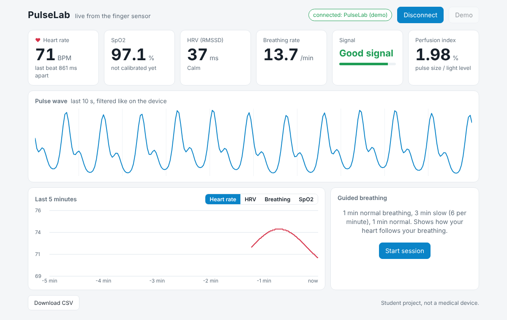
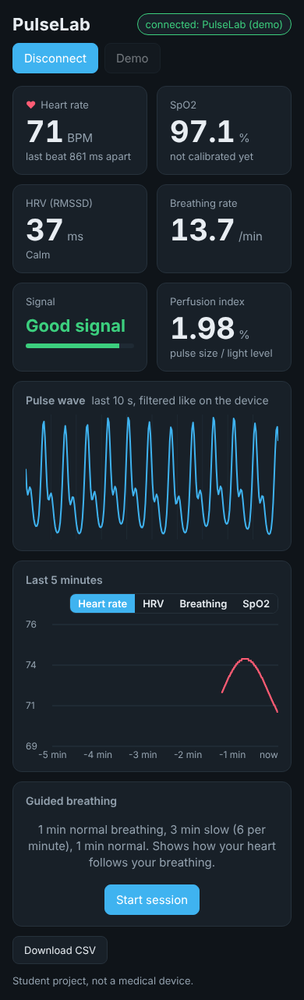
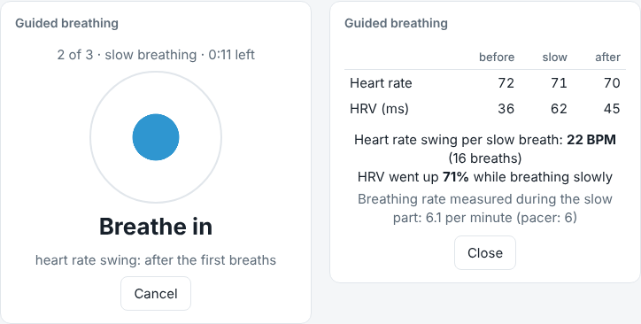
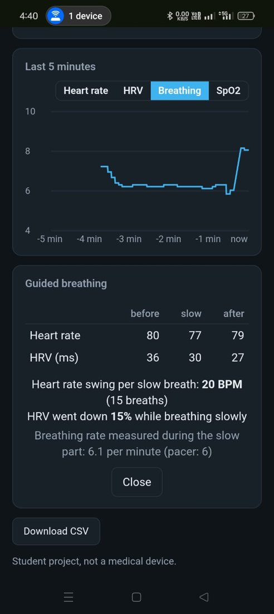

# Phase 8: Bluetooth (BLE) and web dashboard

Code: `firmware/08_ble/` (new: `ble_packets.h`, `ble_link.h`) and `dashboard/` (`index.html`, `pulselab.js`).

Status: works with the board from an Android phone: live data, CSV, guided session started from the page, nRF Connect. Bluetooth doesn't slow the measuring down (loop max 64 ms, 0 FIFO resets). Open: connecting from the laptop.

## What it does

PulseLab now also sends everything over Bluetooth Low Energy, and a web page shows it live. No app needed: Chrome and Edge can talk to Bluetooth devices directly (Web Bluetooth).

(This is the page's demo mode, with made-up data, so it can be shown without the board.)

## Two Bluetooth services

**1. The standard Heart Rate service (0x180D).** This is defined by the Bluetooth SIG, so any app that knows heart rate sensors (nRF Connect, sports apps, ...) shows PulseLab's BPM without knowing anything about it. Each beat sends the BPM and that beat's interval (RR interval, in 1/1024 s, the standard unit). It also says "finger" as the sensor location. BPM is only sent when it's shown on the OLED too, so the phone never gets a value the device itself doesn't trust.

**2. The PulseLab service** (own 128-bit UUIDs) for everything else:

| Characteristic | How often | Size | What's in it |
|---|---|---|---|
| vitals | 2x per second | 20 bytes | state, quality, BPM, SpO2, PI, RMSSD, breathing rate, progress, stress level, guided phase + time left |
| wave | every 320 ms | 18 bytes | 8 points of the filtered pulse (25 per second) + a counter to spot lost packets |
| guided | 4x per second in a session | 8 bytes | phase, paused, breathing in/out, circle size, time left, last swing |
| result | at the end of a session (and readable) | 17 bytes | HR and HRV before / slow / after, swing, breathing rate |
| control | written by the page | 1 byte | 1 = start a guided session, 2 = cancel / close |

The exact byte layout is written down at the top of `ble_packets.h`. Numbers are sent as integers (e.g. BPM x 10 as a 16-bit number) instead of text: smaller, and no parsing problems.

Every packet is **20 bytes or less**. That's the most that fits in one notification with the default BLE packet size (MTU 23). Chrome usually agrees on a bigger size, but this way it also works with apps that don't.

### On the ESP32-C3

- It uses the BLE library that comes with the ESP32 Arduino core. On the C3 that runs on **NimBLE**, a smaller Bluetooth stack.
- Bluetooth makes the program much bigger: 383 KB before, 720 KB now (54% of the flash). RAM: 37 KB of 320 KB for variables, plus what NimBLE takes while running.
- The notification descriptor (0x2902) that the older Bluedroid stack needs is added automatically by NimBLE, so `ble_link.h` only adds it for Bluedroid. (The compiler warned that adding it by hand is deprecated.)
- Nothing is packed or sent when no phone is connected.
- When the phone disconnects, advertising starts again after half a second, so it can reconnect.
- Commands from the page are only stored by the Bluetooth callback and carried out in `loop()`. The callback runs in the Bluetooth task, so this way the guided session is never changed from two places at once.
- The roadmap said to split the firmware into FreeRTOS tasks. I didn't: NimBLE already has its own task, and keeping one loop avoids locking between tasks. If `loop max` shows a problem on the board, that's when to split.
- The status line on Serial now shows `loop max` (the longest loop in the last 2 s), whether BLE is connected, and messages per second. That's to check that Bluetooth doesn't slow the loop down enough to fill the sensor FIFO (160 ms).

## The web page

`dashboard/index.html` + `dashboard/pulselab.js`, plain HTML and JavaScript, no libraries.

- 6 tiles: heart rate (the heart blinks on every beat from the Heart Rate service), SpO2, HRV with the stress level, breathing rate, signal state with quality bar, perfusion index. "--" in the same cases as on the OLED.
- The pulse wave, last 10 s, the same filtered signal as the OLED's wave screen.
- Last 5 minutes of heart rate, HRV, breathing rate or SpO2.
- Guided breathing: a Start button (it sends the command, the device runs the session), a breathing circle that follows the device's pacer, and the before / slow / after result at the end.
- Download CSV of everything received.
- Light and dark mode (follows the system), works at phone width.

 

### Opening it

Browsers only allow Bluetooth on secure pages (`https://` or `http://localhost`), in Chrome or Edge, and not on iPhone. The simplest way is GitHub Pages: in the repo, Settings > Pages > Deploy from branch `main`, folder `/ (root)`. Then it's at `https://gbrobotic.github.io/PulseLab/dashboard/`, also on an Android phone. Details in `dashboard/README.md`.

## Tests

| Test | How | Result |
|---|---|---|
| Packets: firmware vs page | `tests/test_ble_packets.cpp` packs known values with the firmware's code, `tests/test_ble_decode.js` decodes them with the page's code | all 7 packets decode to the right values (incl. clamping, negative wave values, no finger) |
| Packet size | same | all <= 20 bytes (vitals 20, wave 18, guided 8, result 17) |
| Page | headless Chrome (Playwright), demo mode, clock fast-forwarded | no JavaScript errors, no sideways scrolling at 1200 px or 390 px, guided session goes through to the result |
| Firmware | arduino-cli, ESP32-C3, Serial modes 0-3 | compiles, 54% flash |
| Everything from Phases 2-7 | the old tests on the Phase 8 code | all pass |

While testing the page I found a bug in the demo: the pulse phase was worked out as time x heart rate, but the demo heart rate changes over time, so after a minute the wave had ~30 beats in 10 s instead of 12. It now adds up the phase step by step (same idea as `nextBeat_ +=` in the simulator).

## Testing with the board

1. Upload `firmware/08_ble` (Serial Monitor mode). The status line should say `BLE advertising`.
2. **nRF Connect** (free app, Android): scan, connect to "PulseLab". You should see the Heart Rate service; switch on notifications for Heart Rate Measurement and the BPM comes in on every beat.
3. **The page**: open it (GitHub Pages or localhost), Connect, choose PulseLab. Compare the numbers with the OLED.
4. Start a guided session from the page.
5. Watch the status line for a few minutes while connected: `loop max` should stay well under 160 ms and `FIFO resets` at 0.

## First test with the board

20 Oct 2026. Page from GitHub Pages in Chrome, board with `firmware/08_ble`. The page connected and showed everything live; I downloaded the CSV (`validation/logs/dashboard_test1.csv`, 646 rows over 5.5 min, 2 per second as planned).

From the CSV: heart rate mostly 73-90 (median 79), SpO2 96-98%, HRV 19-67 ms, "Good signal" 75% of the time. My finger was off for ~45 s in the middle, and there was some movement around 230-250 s.

**Why the breathing rate was "--" most of the time:** it needs 60 s of steady signal, and starts again from zero when the finger is lifted. The finger came off at ~105 s and again at ~262 s, so it restarted twice. Between ~150 and 230 s there were 60 s of good signal, but the 3 breathing effects didn't agree, so it showed "--" (by design: no number is better than a wrong one). The first value came at the end: 23 /min.

What I changed on the page after this:
- while collecting it now says how long is left ("keep still, 35 s more") instead of a percentage
- when the current minute is unclear, the last clear value stays on screen in grey with its age ("last clear value, 12 s ago") for up to 30 s, then "--"
- the CSV also has the HRV / breathing progress and finger columns, so a recording shows when it was collecting

Checked in headless Chrome by sending made-up packets to the page: collecting -> "keep still, 36 s more", valid -> value, unclear after 12 s -> grey value + age, after 37 s -> "--", finger off -> "--".

## Second test: guided session from the phone

20 Oct 2026. Page on the Android phone (Chrome, GitHub Pages), session started with the page's button, Serial Monitor open on the laptop at the same time (`validation/logs/ble_guided2_serial.txt`, page CSV `dashboard_guided2.csv`).

**Does Bluetooth slow the measuring down?** No. 174 status lines (~6 min), connected the whole time, 10 messages per second during the session:

| | Before Bluetooth (Phase 7) | With Bluetooth connected |
|---|---|---|
| loop max | ~35 ms | usually 10-37 ms, worst 64 ms |
| FIFO resets | 0 | 0 |

The sensor FIFO is full after 160 ms, so 64 ms leaves plenty of room. That's also why I didn't split the firmware into FreeRTOS tasks.

**nRF Connect** (Android) found PulseLab, showed the Heart Rate service and the BPM on every beat. So the standard part works with an app that knows nothing about PulseLab.

**The session:** HR 80 / 77 / 79, RMSSD 36 / 30 / 27 ms, swing 20 BPM per breath (15 breaths), breathing measured 6.1 /min. The page said "HRV went down 15% while breathing slowly", which was the wrong thing to say, see below.

| Check | Result |
|---|---|
| nRF Connect sees the Heart Rate service and BPM | yes |
| Page connects, numbers match the OLED | yes (phone, Chrome, GitHub Pages) |
| CSV download | yes |
| Guided session started from the page | yes |
| loop max while connected | 64 ms worst (10-37 ms usually) |
| FIFO resets while connected | 0 in ~6 min |
| Page on the laptop | didn't connect, not solved yet (see below) |

## RMSSD was the wrong number for slow breathing

The swing was 20 BPM per breath, so the slow breathing clearly worked, but RMSSD went down. Two reasons:

1. **RMSSD measures fast changes.** It's the difference between neighbouring beats. At 6 breaths a minute one breath takes 10 s, about 13 beats, so the heart rate goes up and down *slowly*: a big total swing, but small steps from beat to beat. SDNN (the spread of all intervals) and the swing are what show this slow wave. Shaffer & Ginsberg ([ref 6](REFERENCES.md)): "Greater tidal volumes and lower respiration rates increase RSA", in short recordings the main source of SDNN is RSA "especially with slow, paced breathing", and "The RMSSD is less affected by respiration than is RSA".
2. **The "before" part wasn't calm.** From the beat lines, my heart rate went from 74 up to 91 BPM (5 s averages) in that minute, maybe from settling in or talking. In the slow part the 10 s rhythm is clearly there after ~50 s (67 <-> 80, 70 <-> 83, 73 <-> 82 BPM).

My first session (Phase 7) replayed with SDNN added: **SDNN 20 -> 65 -> 38 ms**, more than 3x up in the slow part (RMSSD was 13 -> 28 -> 13).

What I changed:
- the session also keeps **SDNN** for each part; the OLED result shows HR, RMSSD and SDNN; `GUIDED_CSV` has 3 more columns at the end
- the page compares **SDNN** ("SDNN up 37% while breathing slowly") and no longer says "HRV went down" based on RMSSD
- each part also remembers if the heart rate was **steady** (the same check as "HR changing" in Phase 5). If "before" wasn't, the page says so: not a calm baseline, sit quietly for a minute before starting
- the result packet is still 20 bytes: HR is now a whole number (u8), which makes room for 3 SDNN values, and the 3 "steady" flags use the top bits of the breath count (max 18 in 3 min). The page still understands the old 17 byte packet. Version byte is now 2. The C++ -> JavaScript test covers both.

## Not connecting from the laptop

The page connected from the phone but not from the laptop. Not solved yet; things to check, most likely first:
1. **Only one connection at a time.** If the phone is still connected (page open), PulseLab doesn't advertise, so the laptop can't see it. Close the page on the phone first.
2. **Chrome or Edge**, not Firefox (no Web Bluetooth).
3. **Don't pair it in Windows Bluetooth settings.** Web Bluetooth connects by itself; if PulseLab was paired in Windows, remove it there.
4. The laptop needs **Bluetooth 4.0 (BLE)** and Bluetooth switched on. `chrome://bluetooth-internals` shows if Chrome can see the adapter and lists nearby devices.
5. Mac: System Settings > Privacy > Bluetooth must allow Chrome.

To find out which one it is, the page now says what went wrong instead of just "could not connect": it shows the browser's own error with a hint (no adapter / Bluetooth off, no device chosen, connection failed), and on load it checks if Chrome can use a Bluetooth adapter at all (`navigator.bluetooth.getAvailability()`). It also looks for the device by name prefix and by the heart rate service, and tries the connection a second time if the first one fails (that sometimes happens on Windows). Checked in headless Chrome with a fake Bluetooth object for each error.

